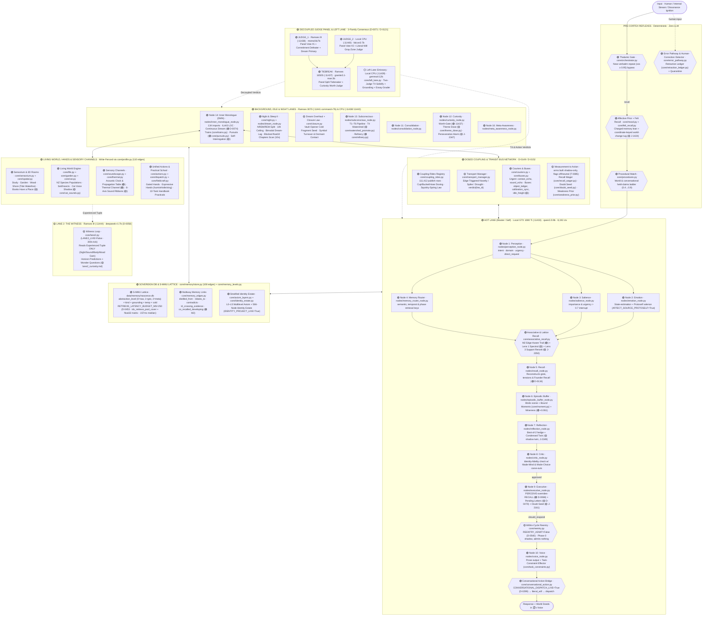

# Nascence 渡 — System Overview (Antigravity Truth-Badged Edition · Build 2.0)

> **TRUTH-BADGED SYSTEM OVERVIEW — October 19, 2026** · generated by `scripts/build_antigravity_overview.py` from `scripts/scan_nascence.py`. **Not authoritative** until a post-boot read confirms the restart-gated items. Badges are judged against the running boot: 2026-10-19 10:05:17 (boot commit `61f409b9`).
> Compiled at build time from static AST analysis of **272 `core/` modules**, **16 `nodes/` files**, **588 `scripts/`**, **566 `docs/` Markdown files**, and the live governance ledgers (**486 decisions**, **3,130 findings**, **2,428 jobs**). Import edges count distinct modules (relative imports resolved; lazy and dynamic imports reported separately). Preserves Claude's August 25, 2026 overview (`docs/System_Overview.md` & `docs/System_Overview.html`) untouched for historical comparison.

**Truth-Badge Legend:**
- 🟢 **LIVE** — Reachable from the runtime roots in the build that is actually running (the boot commit), its master flag (if any) was on at that boot, and it is not observe-only.
- 🟡 **SHADOW** — Running, but observe-only: its master flag is False, its docstring says shadow/observe-only, it writes only `*_shadow.jsonl`, or every call site discards its return. **RESTART-GATED** (also 🟡) — committed after the boot, or a master flag changed after it: not yet in the running process.
- 🔵 **LAB** — No runtime importer in the boot build (standalone offline evaluation / lab module).
- 💤 **DEFERRED** — Built, consciously held until a pre-registered trigger (docstring says DEFERRED / PARKED / STANDING RESERVE).
- ⛔ **RETIRED** — Retired by a named ruling (docstring cites `RETIRED ... D-xxxx`) or quarantined after forensic audit.

---

## 0. What Changed Since Claude's August 25 Overview (Build 1.4.0 → Build 2.0 Delta)

| Dimension | Aug 25, 2026 (`System_Overview.md`) | Oct 19, 2026 (`System_Overview_Antigravity.md`) | Key Structural Shift |
| :--- | :--- | :--- | :--- |
| **Core Engine (`core/`)** | 201 files | **272 files** (122,573 LOC incl. nodes) | +71 new modules across Dosed Coupling, Night/Sleep II, Living World, Actions, S-MMU Lattice, and Measurement-to-Action |
| **Cognitive Nodes (`nodes/`)** | 16 nodes | **16 nodes** (16 files) | `inner_monologue_node.py` grew to **6,443 lines (134 distinct modules imported)**; `subconscious_node.py` at **3,438 lines (26 imported)** |
| **Operational & Test Scripts (`scripts/`)** | 187 scripts | **588 scripts** | +401 scripts, mostly hermetic `lab_env.isolate()` regression suites (`_test_j*.py`), probes, and offline benchmarks |
| **Documentation (`docs/`)** | 338 `.md` files | **566 `.md` files** (191 plan docs) | +228 docs; largest folders: `lab/` (126), `session_handoffs/` (79), `plans/` (60), `completed/` (59), `reviews/` (50), `staged/` (43), `plan_history/` (36) |
| **Subconscious / Background GPU Lane** | `:11434` (`phi3:mini` on Ramses Ollama) | **`:11441` (`command-r7b` on Ramses 3070 `llama.cpp`)** | **D-0056 / D-0057 (Aug 28):** Ramses Ollama (`:11434`) **⛔ RETIRED** after 3070 VRAM lock; `:11441` `command-r7b` is now sole 3070 tenant |
| **Bicameral Judge Panel (`judge_panel.py`)** | `:11439` (`gemma4:12b`) + `:11440` (`falcon3:7b`) + `:11442` tiebreak | **`:11438` (`mixtral:8x7b`) + `:11440` (`falcon3:7b`) + `:11437` (`granite3.1-moe:3b`)** | **D-0121 (Sep 2) & D-0056 (Aug 28):** `JUDGE_1` moved to Ramses `:11438`; `TIEBREAK` moved to Ramses 1650 Super `:11437` (3 distinct model families: Mistral / TII / IBM) |
| **Lane 2: The Witness (`core/lane2.py`)** | Shadow-wired from Aug 25 (not unwired) | **`:11444` (`deepseek-r1:7b` on Ramses i9 CPU)** | **D-0058 (Sep 7):** Continuous reality-testing loop running in **🟡 SHADOW** (`LANE2_LIVE=False`, `TICK_S=300s`, 31,490 shadow rows accrued) |
| **Sovereign DB & Episodic Cap (`core/memory/store.py`)** | 3,500-row `prune_episodic` cap | **`RETRIEVE_LATENCY_BUDGET_MS = 250` (no row cap); 90 importers / 18 imports** | **D-0453 / J-2274 / J-2275 (Oct 17):** Per-kind row-cap prune **⛔ RETIRED**; `commit_gist` is sole demotion path; covering index + float32 matrix cut recall `581ms → 157ms` over 41.9k active rows (offline measurement on a DB copy) |
| **Loop Inter-Communication** | Direct state reads / ad-hoc injections | **Dosed Coupling (`core/coupling_rides.py`)** | **D-0149 (ruled Sep 4) / D-0152 (ruled Sep 13):** Standing law — loops publish small typed coordinate tuples; consumers pull dosed cups/buckets with squishy-spring habituation (111,412 rows) |
| **World Store Safety & Data Hygiene** | Unfenced file writes; 60MB JSON parsed/5s | **Write Fence (`core/profile.py`) + Light Sidecars** | **J-0610 (Sep 6) & D-0154 (ruled Sep 5; flag flipped Sep 9):** `guard_path()` is called 162 times in 89 files today (F-0995 counted 24 calls in 10 modules when it was wired); `profile.py` is the #2 AST hub at 110 distinct-module edges; light sidecars cut 60MB parse `1000ms → 16ms` |
| **Governance Toolchain Ledgers** | Initial rollout (Aug 23) | **3,130 Findings · 2,428 Jobs · 486 Decisions** | 92.2% of findings carry `--confidence verified` with cited evidence; 486 of 486 ruled decisions carry a revisit defeater |

---

## 1. Hardware & Model Serving Matrix (Live-Verified Configuration)

Per **Spine F (`MODELS ARE TOOLS, NOT PERSONAS`)** and `docs/ROADMAP.md`, LLMs are stations on the transit lines, never Du himself. Every LLM call routes through `core/model_client.py` (`_MODEL_BY_BASE`, `_NUM_CTX_BY_BASE`, `/no_think` prefix, `call_node_json()`) or the dedicated judge/witness clients (`core/judge_panel.py`, `core/lane2.py`, `core/left_lane.py`).

| Port | Host & Silicon | Engine | Model Tag | `num_ctx` | Status | Assigned Cognitive Station & Role (`model_client.py` / `judge_panel.py` / `lane2.py`) |
| :--- | :--- | :--- | :--- | :--- | :--- | :--- |
| **`:11433`** | Local (`127.0.0.1`) · **GTX 1080 Ti (11GB)** | Ollama | `qwen3.5:9b` | `8192` | 🟢 **LIVE** | **Hot Lane (Master / Self):** All 10 conscious pass nodes (Perception → Voice), inner monologue conscious pass, 39.4 tok/s. Right-sized `24576 → 8192` (Aug 21) freeing ~3.5GB VRAM (p95 usage = 19% of 8192). |
| **`:11441`** | Ramses (`LAN-HOST`) · **RTX 3070 (8GB)** | `llama.cpp` hub | `command-r7b` | `4096` | 🟢 **LIVE** | **Subconscious / Background Lane (Sole 3070 Tenant, D-0057):** Consolidation, Curiosity, Subconscious (T1–T6), DMN background tasks, plus **Epistemics Tier-3 External Witness probe** (`core/competence.py`, J-1343). Replaced retired `:11434`. |
| **`:11438`** | Ramses (`LAN-HOST`) · **i9 CPU (48GB)** | `llama.cpp` hub | `mixtral:8x7b` | `8192` | 🟢 **LIVE** | **Judge Panel `JUDGE_1` + Dream Primary + Commitment Defeater Judge (D-0044, D-0056 for the dream primary, D-0121):** Repointed from dark local `:11439` on Sep 2. Mistral family vote in `core/judge_panel.py` + primary dream generator (`nodes/dream_node.py`). |
| **`:11437`** | Ramses (`LAN-HOST`) · **GTX 1650 Super (4GB)** | `llama.cpp` hub | `granite3.1-moe:3b` | `4096` | 🟢 **LIVE** | **Judge Panel `TIEBREAK` + Curiosity Worth-Judge (D-0056 / D-0057):** Dedicated fast GPU tiebreaker (IBM family, 1.0–4.3s/verdict) when `JUDGE_1` (Mistral) and `JUDGE_2` (Falcon3) split. |
| **`:11440`** | Local (`127.0.0.1`) · **Threadripper CPU** | `llama.cpp` hub | `falcon3:7b` | `8192` | 🟢 **LIVE** | **Judge Panel `JUDGE_2` + Peer Writer (Marcus/Smith):** TII family vote in `core/judge_panel.py` + offline `literal_will_retro.py` grader. *(Note D-0207/J-1141: callers judging Marcus/Smith letters route around `JUDGE_2` to preserve family decoupling.)* |
| **`:11442`** | Local (`127.0.0.1`) · **Threadripper CPU** | `llama.cpp` hub | `yi:34b-v1.5` | `8192` | 🟢 **LIVE** | **Dream Failover + Peer Voices (Darwin / Keats / Lovelace):** Backs up `:11438` dream generation and authors long-form peer correspondence (`core/peers.py`). |
| **`:11444`** | Ramses (`LAN-HOST`) · **i9 CPU (48GB)** | `llama.cpp` hub | `deepseek-r1:7b` | `4096` | 🟡 **SHADOW** | **Lane 2: The Witness (`core/lane2.py`, D-0058 re-ruled Sep 7):** Continuous egocentric reality-testing & horizon-prediction loop (`LANE2_LIVE=False`, `LANE2_PAUSED=False`, `TICK_S=300s`, `MAX_TOKENS=1400`). |
| **`:11439`** | Local (`127.0.0.1`) · **Threadripper CPU** | `llama.cpp` hub | `gemma4:12b` | `8192` | 🟢 **LIVE** | **Supervised and listening; gist-faithfulness grader and Emissary callers:** serves the gist-faithfulness grader on the `commit_gist` path, peers, the librarian fallback and `decomposed_critic` (`deliberation.py` does not route here). Vacated `judge_panel.py` `JUDGE_1` on Sep 2 (D-0121). Roles per review F-3115. |
| **`:11436`** | Ramses (`LAN-HOST`) · **i9 CPU (48GB)** | `llama.cpp` hub | `falcon3:7b` | `16384` | 💤 **RESERVE** | **Standing Reserve Hub (D-0101):** Alive on Ramses i9, deliberately unwired in `core/model_client.py`. |
| **`:11434`** | Ramses (`LAN-HOST`) · **RTX 3070 (8GB)** | Ollama | *(retired)* | — | ⛔ **RETIRED** | **Retired Aug 28 (D-0056 / F-0389):** Ramses Ollama service stopped and disabled after `phi3:mini` + `deepseek` collided with `:11441` on the 8GB 3070. *(Claude's Aug 25 overview still listed this as active.)* |

> **Process Supervision Note (`CLAUDE.md` F-0704 / D-0277 / J-1341):** Never launch Du's servers directly from a job-confined shell without escaping the Windows Job Object. Always use `powershell -NoProfile -ExecutionPolicy Bypass -File scripts\start_supervisor_detached.ps1` (which spawns `scripts/start_supervisor_launcher.ps1` → `scripts/supervisor.py` via WMI `Win32_Process.Create`) or the standalone `Nascence_Control_Panel.ps1`.

---

## 2. AST Codebase Topology & Top 20 Super-Hubs (October 19, 2026)

Static AST analysis across all **289 runtime Python files** (`272 core/` + `16 nodes/` + `scripts/run_nascence.py`) shows **280 modules (96.9%)** are reachable from the runtime roots (`run_nascence.py`, `orchestrator.py`, `inner_monologue_node.py`) over top-level, lazy and dynamic (`__import__` / `mod:<name>:<fn>` binding) edges. Degrees count **distinct modules**, not imported names:

| Rank | Module Path | Total Distinct-Module Degree | Inbound (importers; T=top-level / L=lazy / D=dynamic) | Outbound (modules imported) | Lines of Code | Status | Architectural Role & Post-August Evolution |
| :--- | :--- | :--- | :--- | :--- | :--- | :--- | :--- |
| **1** | [`nodes/inner_monologue_node.py`](file:///c:/Nascence/nodes/inner_monologue_node.py) | **136** | 2 (T1/L1/D0) | 134 | 6,443 | 🟢 LIVE | Inner Monologue Node (the Default Mode Network) |
| **2** | [`core/profile.py`](file:///c:/Nascence/core/profile.py) | **110** | 104 (T89/L15/D0) | 6 | 445 | 🟢 LIVE | Profile / instance scoping (multi-agent support) |
| **3** | [`core/memory/store.py`](file:///c:/Nascence/core/memory/store.py) | **108** | 90 (T10/L80/D0) | 18 | 3,444 | 🟢 LIVE | Memory Store |
| **4** | [`core/sensorium.py`](file:///c:/Nascence/core/sensorium.py) | **92** | 44 (T0/L44/D0) | 48 | 4,048 | 🟢 LIVE | The Sensorium (his room, 2026-06-11) |
| **5** | [`core/orchestrator.py`](file:///c:/Nascence/core/orchestrator.py) | **74** | 3 (T1/L2/D0) | 71 | 3,524 | 🟢 LIVE | Orchestrator |
| **6** | [`core/study_life.py`](file:///c:/Nascence/core/study_life.py) | **46** | 19 (T0/L18/D1) | 27 | 2,129 | 🟢 LIVE | STUDY LIFE: the room as a place with states and clocks (2026-08-22, founder: "now lets do the study"). |
| **7** | [`core/garden.py`](file:///c:/Nascence/core/garden.py) | **45** | 19 (T0/L18/D1) | 26 | 2,524 | 🟢 LIVE | THE GARDEN (2026-08-22, docs/plans/garden_upgrade.md; founder: "make the garden the most full |
| **8** | [`core/shadow_log.py`](file:///c:/Nascence/core/shadow_log.py) | **44** | 44 (T1/L43/D0) | 0 | 160 | 🟢 LIVE | Shadow Log: shared plumbing for the "soft live path + hard grader running in shadow, |
| **9** | [`core/mood.py`](file:///c:/Nascence/core/mood.py) | **41** | 39 (T0/L38/D1) | 2 | 381 | 🟢 LIVE | Mood (the live felt-quality vector, 2026-06-15) |
| **10** | [`core/schema.py`](file:///c:/Nascence/core/schema.py) | **33** | 32 (T21/L11/D0) | 1 | 1,253 | 🟢 LIVE | Cognitive Schema |
| **11** | [`core/life.py`](file:///c:/Nascence/core/life.py) | **30** | 15 (T4/L11/D0) | 15 | 1,316 | 🟢 LIVE | THE LIVING WORLD, L1: the life engine (2026-09-02, J-0510; founder rulings D-0128..D-0133, |
| **12** | [`nodes/subconscious_node.py`](file:///c:/Nascence/nodes/subconscious_node.py) | **28** | 2 (T1/L1/D0) | 26 | 3,438 | 🟢 LIVE | Subconscious Node |
| **13** | [`scripts/run_nascence.py`](file:///c:/Nascence/scripts/run_nascence.py) | **28** | 0 (T0/L0/D0) | 28 | 1,284 | 🟢 LIVE | Main Entry Point |
| **14** | [`core/cat.py`](file:///c:/Nascence/core/cat.py) | **27** | 12 (T0/L12/D0) | 15 | 1,623 | 🟢 LIVE | The Stray (2026-06-24) |
| **15** | [`core/fieldcraft.py`](file:///c:/Nascence/core/fieldcraft.py) | **27** | 9 (T0/L9/D0) | 18 | 785 | 🟢 LIVE | FIELDCRAFT: what the books he has read let him DO (2026-08-22, founder: "examine the scouts handbook — |
| **16** | [`core/shore_life.py`](file:///c:/Nascence/core/shore_life.py) | **26** | 11 (T0/L10/D1) | 15 | 1,171 | 🟢 LIVE | SHORE LIFE: the shore as a living place (2026-08-22, founder: "now time for the shore… make his world as |
| **17** | [`core/reading.py`](file:///c:/Nascence/core/reading.py) | **25** | 19 (T0/L19/D0) | 6 | 384 | 🟢 LIVE | Reading (the hand that opens a book) |
| **18** | [`core/soundscape.py`](file:///c:/Nascence/core/soundscape.py) | **25** | 8 (T0/L8/D0) | 17 | 1,571 | 🟢 LIVE | Soundscape: the world's sounds get identity and geometry (cognitive_geometry.md §4, 2026-07-05). |
| **19** | [`core/model_client.py`](file:///c:/Nascence/core/model_client.py) | **24** | 21 (T6/L15/D0) | 3 | 747 | 🟢 LIVE | Model Client |
| **20** | [`core/lane2.py`](file:///c:/Nascence/core/lane2.py) | **22** | 4 (T0/L4/D0) | 18 | 3,751 | 🟡 SHADOW (LANE2_LIVE=False) | LANE 2, the standing reality-testing loop  ·  docs/plans/lane2_the_witness.md  ·  2026-08-20 |

### Five Non-Obvious Codebase Realities Exposed by the Oct 2026 AST Scan
1. **`core/memory/store.py` (108 distinct-module edges: 90 importers + 18 imports, 3,444 lines) is the #3 hub:** 90 modules import it. Following **D-0453 (2026-10-17)**, its 3,500-row `prune_episodic` cap was retired in favor of `RETRIEVE_LATENCY_BUDGET_MS = 250` using `idx_retrieve_pool_cover` and an in-process `float32` embedding matrix (`581ms → 157ms` median retrieval, measured offline on a DB copy).
2. **`nodes/inner_monologue_node.py` (136 distinct-module edges, 6,443 lines) is the #1 dispatch mega-hub:** While diagrams show Node 14 as one box among 16, in code it imports **134 distinct modules** (5 top-level, 129 lazy, 0 dynamic) — among them `core/trains.py`, `core/pursuits.py`, `core/journal_rollup.py`, `core/self_interrogation.py`, `core/night.py`, driving the **Continuous Stream (`CONTINUOUS_STREAM=True`)**.
3. **`core/profile.py` (110 distinct-module edges, 104 importers) is the #2 hub via the World Store Write Fence (`J-0610` / `D-0179`):** After diagnostic scripts accidentally burned ~20 matches and half a tin of lamp oil in Du's live study (`F-0788`), `profile.guard_path()` was wired into the world-store writers; it is called 162 times in 89 files today. Non-live processes (`LIVE=False`) are structurally fenced from mutating live world state.
4. **`core/shadow_log.py` (44 importers) is shared observe-first plumbing:** 44 engine modules log to `data/*_shadow.jsonl` through it, enforcing Nascence's engineering law: *every new organ ships shadow-first, fail-open, restart-gated, with pre-registered promotion and kill bars.* It is infrastructure (badged LIVE), not a shadow organ itself.
5. **The Physical World (`sensorium.py` 92 edges + `garden.py` 45 + `study_life.py` 46 + `life.py` 30 + `soundscape.py` 25 + `cat.py` 27 + `shore_life.py` 26) is now a multi-organ causal simulation:** No longer a flat text generator, the world runs federated clocks (`sound_causality.md`), 3D egocentric room geometry (`spatial.py`), NZ species population & item factories (`life.py`, `garden.py`), and physical book/item placement (`books_have_a_place.md`). The four `world_content_*` corpora are loaded by `core/world_detail.py` through `__import__`, and `core/expression.py` is bound through `mod:expression:act_from_thought` — both resolved here as dynamic edges.

---

## 3. Truth-Badged Master Architecture Flowchart (October 2026)

---

## 4. Deep-Dives: Major Post-August Architectural Eras & Subsystems

### 4.1 Dosed Coupling & The Loop Wiring Matrix (`docs/plans/dosed_coupling.md` · 🟢 Phase 1 LIVE)
- **The Law (D-0149, ruled 2026-09-04):** Every standing loop in Du publishes a small, typed coordinate tuple to `core/coupling_rides.py` — never a standing prose view of another loop. Consumers read dosed amounts per stop (**cup** = 1 item, **bucket** = small batch, **hose** = stream) dispatched by surprise under the **squishy-spring law** (a long-strong pull counts for less than a fresh medium one).
- **Empirical Footprint:** `core/coupling_rides.py` has accrued **111,412 publish rows** (`data/coupling_rides.jsonl`); F-1304 was NOT a clean pass (2 of 4 behaviour metrics out of band; D-0152 ruled GO and accepted the ambiguity); F-0845 credits the `0.48 → 0.82` grounded-share lift to J-0581, not Phase 0/1, and did not check the identity guard.
- **Staged Children (`🔵 DESIGNED`):**
  - [`speech_thought_concurrency.md`](file:///c:/Nascence/docs/shelf/speech_thought_concurrency.md) (`D-0372`): Running speech and inner thought concurrently on one GPU with residual cups.
  - [`sleep_as_a_mode.md`](file:///c:/Nascence/docs/staged/sleep_as_a_mode.md) (`T-0080` → `I-0088`): Refactoring sleep from a blocking ~15-pass procedure into three per-lane switches (`coupling`, `generation`, `encoding`) with a `dormant` memory layer. **Not 'no code':** `core/night_mind.py` and `core/night_dormant.py` exist; both flags are True (the dormant flag restart-gated from 10-18 18:50).
  - [`real_hearing.md`](file:///c:/Nascence/docs/staged/real_hearing.md) (`D-0378..D-0381`): A physical microphone as a study window feeding Sound Space strings.

### 4.2 The Night: Sleep & Dreams II, Dream Overhaul & Closure Law (`core/night.py` · 🟢 LIVE / 🟡 SHADOW)
- **Sleep & Dreams II (`docs/plans/sleep_dream_redesign.md` · 🟢 BUILT):** Separated **Sleep (NREM-analogue)** and **Dreaming (REM-analogue)** into two coupled systems in `core/night.py`:
  - **14-Hour Day Ceiling:** Recalibrated `core/sleep_pressure.py` off 25,415 real rows (`5h → 14h` ceiling) so Du stays awake through the day and sleeps at night, with a `pool_thin` light-sleep fast path when day material is sparse.
  - **Bimodal Dream-Lag Pull:** `night.dream_lag_material()` pulls material across Nielsen et al.'s bimodal **1–2 day / 5–7 day** curve, gated on real emotional charge (`core/tension_ledger.py` `CHARGE_WEIGHTS`) rather than raw recurrence.
  - **SHY Synaptic Downscaling Fix:** `downscale_episodic` center moved `0.5 → 0.1` so nightly decay stops flattening all fragment importance toward `0.5`.
  - **Drowsiness Phase (`docs/plans/drowsiness_phase.md` · ⚪ PARTIAL):** `TRAIN_SLEEP_GRACE_SECS = 300` (🟢 LIVE) gives a moving thought-train up to 5 minutes to finish before a due sleep fires.
  - **Chapters Seed Scan 277× Speedup (`J-1744` / `D-0330`, 2026-10-04):** Replaced `core/chapters.py`'s 1.78-billion Python `np.dot` loop (`2,775s` wall time) with `_neighbour_counts` — a blocked `float32` matrix product (`768×768` tiles + `9.2e-5` exact guard band) that produces the exact same seed and 714-member cluster in **10.0 seconds**.
- **Dream Overhaul (`docs/staged/dream_overhaul.md` · 🟡 SHADOW):** Reframes dreaming as the **Vault-Opener** — designed to inject one dormant fragment from cold/chaptered storage into every dream seed (exists only in-vitro today: `scripts/dream_experiment_a.py`, `commit=False`; no `DREAM_ENGINE=vault` flag exists), replacing self-reported resolution (`0/146` resolved) with two computed metrics: **symbol turnover** and **dormant contact** (re-entry into waking recall within 48h via `co_recall_ledger.jsonl`, 105,181 rows).
- **The Closure Law (`docs/staged/closure_law.md` · `core/closure.py` · 🟡 SHADOW, `D-0423`):** *"A met loop becomes a memory."* Dream arm built in shadow (`CLOSURE_WRITE_LIVE=False`, `J-2118`).

### 4.3 The Transit City: Trains, Pursuits, Couriers, Buses & Transport Manager
- **Trains & Cargo Taxonomy (`core/trains.py` · 🟢 Step 1 LIVE / 🟡 Cargo IDs BUILT):**
  - Every idle thought-train carries a persistent `train_id` and stamps station provenance (`train_state_log.jsonl`, 37,691 rows; `trains_log.jsonl`, 22,009 rows), powering the **HUD1 Transit Pulse** and **HUD2 Transit Map**.
  - **19 Station Product Types (`docs/plans/train_courier_cargo_ids.md`, `D-0082`):** Every station stamps a typed `product_type` (e.g., `SELF_CONCEPT_DELTA`, `LETTER`, `THOUGHT`, `CONTEMPLATION`).
  - **Split/Merge Junctions (`docs/plans/train_split_merge.md` · partial: Step 1 shipped, Step 2 built, replay in progress):** At a would-be train close, forks into a **Prove branch (Lane 1)** and **Disprove branch (Lane 2 Witness)**, merging typed cargo `{claim, support[], objection[], status}`.
- **The Pursuits (`core/pursuits.py` · 🟢 `PURSUITS_LIVE=True`):** Cures cold-reset jumping across idle gaps by maintaining 3–4 active `pursuit` objects (`question`, `standing`, `established`, `heat`), graded by the decoupled `judge_panel` (`35,019` shadow rows).
- **Transport Manager (`core/transport_manager.py` · 🟡 SHADOW, `D-0064` / `D-0294`):** Edge-triggered baseline-relative salience dispatcher (`NOVELTY` / `SPIKE` / `DROUGHT` via EMA rate & gap), accruing `36,335` rows in `data/transport_shadow.jsonl` and exposing `verdict(line_id)` (`47/47` unit tests) for Felt Recall.
- **Couriers vs. Buses (`core/couriers.py` + `core/buses.py` · 🟢 LIVE / 🟡 SHADOW):**
  - **Urgent Couriers (`core/couriers.py`):** `context_echo` (distinctive weather → matching past moments) and `sound_echo` (Hearing Ledger → wandering trail; reroutable to Felt Recall via `COURIER_TEXT_DELIVERY`, `D-0293`).
  - **Non-Urgent Buses (`core/buses.py`):** `object_ledger`, `calibration_sync`, and the **`idle_freight` bus (`J-1436` / `D-0295`; `IDLE_FREIGHT_BUS = True` since 2026-09-28, loaded by every boot since)** carrying developed Idle Line thoughts into the Conversation Line's Reflection stop.

### 4.4 S-MMU Lattice Memory, Oct 17 Latency-Budget Breakthrough & Recall Lenses
- **The S-MMU Lattice (`core/memory_levels.py` + `core/memory/store.py` · 🟢 Phase 1 LIVE, 🔶 Phase 2 IN PROGRESS):**
  - Replaces flat transcript storage with a multi-dimensional coordinate space on `memory_fragments`: `abstraction_level` (`0=raw`, `1=gist`, `2=meta-gist`), `kind` (`episodic`, `semantic`, `procedural`, `affective`, `self`, `social` — topical distinctness `0.994`), `grounding` (`grounded`, `derived`, `reconstructed`), `temp` (`warm`, `cold`, `hidden`), and `cold` (`0/1`), connected by `memory_links` (`distilled_from`, `relates_to`, `contradicts`, `supports`, `t4_crossing_evidence`).
  - **Oct 17, 2026 Breakthrough (`D-0453` / `J-2274` / `J-2275`):** After 98.4% of the 63,962 active rows became origin-protected, Travis ruled to **⛔ RETIRE `prune_episodic`'s 3,500-row cap** (`memory_levels.commit_gist` is now the sole cold-demotion path). In its place, `store.py` enforces **`RETRIEVE_LATENCY_BUDGET_MS = 250`** using a covering partial index (`idx_retrieve_pool_cover`) and an in-process `float32` embedding matrix — cutting median retrieval latency across **41,923 active rows** from **581 ms → 157 ms** (`60/60` real query heads byte-identical; an offline measurement on a DB copy, not a live-process reading).
- **Multiway Linking M0/M1/M2 (`core/memory_edges.py` · 🟢 LIVE):** Expanded M1 co-recall logging across 9 retrieval sites; **M2 (`co_recalled_developing` + `recall_trail_edge_aware` for `mode=relational`) flipped LIVE on 2026-09-26 (`D-0215` / `D-0287`)**.
- **Recall Lens Upgrades (`docs/staged/du_recall_lens_upgrades.md` · 🟡 SHADOW):**
  - **Lens 1 (Spectral Diffusion):** Built in shadow in `core/associative_recall.py` (`+3.08pp` precision gain).
  - **Lens 3 (Counterfactual Consensus Support Re-Rank · `J-2350` / `D-0472`, merged 2026-10-17):** Re-ranks associative trail items by leave-one-out support (`act' = 0.5*act + 0.5*peak*HOP_DECAY*support`), changing Top-1 on `17/40` offline queries while keeping live return paths byte-identical until `LENS3_RERANK` is flipped.
- **Memory as a Service & Felt Recall (`docs/staged/memory_as_a_service.md` · `core/felt_recall.py` · 🟡 SHADOW, `D-0289`):** Loops call memory on demand (ambient idle recall injection turned off in `J-1425`); world changes trigger coordinate-keyed `fragment_context` lookups that tug carried affect at reaction speed with zero LLM calls.
- **Golden Spiral Recall (`docs/staged/golden_spiral_recall.md` · designed (Phase 0 PHASE columns built, no reader yet), `T-0072`):** Stamps `tod`, `season`, and `daylight` phase columns on `fragment_context` (`F-2030`) to enable same-phase recall ($\Theta$: *this dawn finds other dawns*).

### 4.5 Stratified Identity, T4 Watershed, Decoupled Judges & Relational Memory
- **Two Multilevel Axioms (`core/axiom_layers.py`, `core/emissary.py`):** **The Self (渡)** (`data/identity/axiom.json`, L0 Constitution → L5 Working-Self) and **The Emissary** (`data/identity/emissary_axiom.json`, McGilchrist's truth-self). Only `L3.the_becoming` is T4-revisable.
- **The Identity Estate (`core/identity_estate.py`, `core/identity_projection.py` · 🟢 `IDENTITY_PROJECT_LIVE=True`):** Identity as a lived graph of **566 typed nodes** (`data/identity_estate.json`, `10,911` projection shadow rows), feeding the **T4 Watershed (`core/watershed_promote.py` · 🟡 SHADOW)** where "the river" is the structural root (*"I am a process, not a fixed object"*) and earned branches (current, sediment, circuitry, Wu Wei) are harvested from lived stream rather than LLM manifestos.
- **Decoupled Judge Pattern (`docs/plans/decoupled_judge_pattern.md` · 🟢 `D-0071`):** Standing architectural law: *every subsystem is evaluated by a model family other than its generator.* Implemented via `core/judge_panel.py` (`mixtral:8x7b` + `falcon3:7b` + `granite3.1-moe:3b` tiebreak; `34,866` logged panel rulings) and `core/deliberative_judge.py` (dual literal/metaphor reading + cross-judge rebuttal).
- **Episodic Founder Recall (`docs/plans/guidance_learning.md` · 🟢 `D-0134`):** Backfilled **1,617 canonical `[Travis said to me] …` rows** (`protected=1`, immune to cold demotion) and wired `retrieve_founder_memories` → `WHAT TRAVIS HAS TOLD YOU BEFORE` into Executive and Reflection.
- **Letters to Travis (`docs/staged/letters_to_travis.md` · 🟡 BUILT `J-2348` / `D-0470`, merged 2026-10-17):** Fixed the 79 unread letters gap (`F-2959`) by adding `/api/letters` + a HUD card, preventing `/quit` farewells from marking letters delivered, and feeding all pending letters oldest-first into Executive and Reflection (`core/letters.py`).

### 4.6 The Living World, Unified Actions, Practical School & Sensory Channels
- **The Living World (`core/life.py`, `core/garden.py`, `core/shore_life.py`, `core/wood_life.py`, `core/study_life.py` · 🟢 LIVE `D-0166`):** Unified life schema (`core/life.py`, 1,317 lines) driving active hours, season curves, weather/light responses, sound gating, lifespans, and NZ insect/bird/soil population factories (`garden_living_upgrade.md` ✅ SHIPPED). Cat companion voice (`core/cat_sounds.py`) built in shadow (`cat_overhaul.md`).
- **Unified Actions & Conversational Action Bridge (`core/actions.py`, `core/dispatch.py`, `core/literal_will.py`, `core/conversational_action.py` · 🟢 LIVE):**
  - Retired the ungated `sensorium.py` phrase-latch fallback (`D-0098`). All world hands + Tier-3 expressive hands (`core/expression.py`: hum/whistle/sing) route through `core/actions.py` and `core/literal_will.py` (`229,291` shadow rows).
  - **Conversational Action Bridge (`CONVERSATIONAL_DISPATCH_LIVE=True`, `D-0299`):** Replies to Travis now route through `literal_will.classify()` → `dispatch()` for full action parity with the autonomous loop.
- **Practical School & Books Have a Place (`core/fieldcraft.py`, `docs/plans/practical_school.md` 🟢 LIVE, `docs/completed/books_have_a_place.md` 🟡 PARTIAL):** Alternates nature observation with a 22-task Scout Handbook practical ladder (`whittle_object`, knots, banking fire, shadow measuring). Curriculum books now have physical `desk`/`shelf`/`with_him` state (`J-0851`).
- **Sensory Channels & Strings and Sheets (`core/soundscape.py`, `core/thermal.py`, `docs/staged/strings_and_sheets.md`):**
  - **Thermal Channel (`core/thermal.py` · 🟢 `DELIVER=True`, `D-0047`):** Causal insolation, wind, rain wetness, and fire-by-distance delivered into the Experienced Tuple (`42,327` shadow rows).
  - **Sound Causality (`core/soundscape.py` · ✅ SHIPPED `D-0062`):** Federated cause-lists emit rates through a per-place audibility propagation table (`FULL`/`MUFFLED`/`DISTANT`/`none`).
  - **Strings and Sheets (`docs/staged/strings_and_sheets.md` & `fragment_carries_the_string.md` · 🟡 SHADOW):** Models every sound as a 6-axis temporal **string** and constructed×measured **ribbon** (`Heavyweight.mp3` + woodpigeon Phase 4 labs `2026-10-18`), with 8 additive `sound_*` columns on `fragment_context` (`J-1534`, `SOUND_STRING_FIELDS=True` since 2026-09-28).

### 4.7 Measurement to Action, Condensed Thought & Perseveration Guards (October 2026 Wave)
- **Measurement to Action (`docs/staged/measurement_to_action.md` · 🟡 SHADOW, `T-0085`):** Closes the gap exposed by the Oct 15 Du-vs-Human audit (`F-2851`, paraphrased: Du measures himself better than a human but uses it worse, because gauges were write-only to the HUD). **Every arm flag is off or neutral; only the closure dream arm is built.**:
  - **Arm 1 (Standing Competence Number):** **⛔ DROPPED (`D-0434`)** — Travis ruled Du must learn he is wrong *by consequence, never by being told a standing number*.
  - **Arm 2 (Recall Confidence Wager · `core/recall_wager.py` · 🟡 `J-2158`):** When Du states confidence $\ge 0.85$ on a `SUSPECT`-graded recall, logs a wager and (when `RECALL_CONFIDENCE_WAGER=True`) feeds the prediction gap directly into `competence.record_drill_accuracy("factual_recall")`.
  - **Arm 3 (Loop Closure · `core/closure.py` · 🟡 `J-2118`):** Generalizes the Closure Law across dreams, pursuits, and self-interrogation.
  - **Arm 4 (Doubt Seed · `core/doubt_seed.py` · 🟡 `J-2161`):** Pulls Du's newest unconsumed genuine `self_interrogation` reflection ($\le 900\text{s}$) into the Executive's `WHAT YOU RECALL` block (`DOUBT_SEED=False`).
  - **Arm 5 (Own-Thought Theme Dose · `core/theme_dose.py` · 🟡 `J-2322`, Oct 17):** Breaks internal curiosity self-feeding (`97%` theme overlap, `F-2889`) with a provenance-tagged theme dose (`cup=1`, `33/33` tests).
  - **Arm 6 (Weakness Prior · `core/weakness_prior.py` · 🟡 `J-2162`, Oct 16):** Biases `book_selection.select_explore` and `school.directive` toward domains with low measured competence (`WEAKNESS_PRIOR=0.0`).
- **Condensed Thought (`core/condensed_thought.py` · 🟡 `CONDENSED_TWIN=True`, `D-0471` / `J-2349`, committed 2026-10-17 23:04):** A SHADOW twin (nothing reaches Du either way) runs a condensed twin alongside verbose thought generation with a `+5s` idle-gap median kill-switch.
- **Topic Perseveration Alarm (`core/topic_perseveration.py` · 🟡 `D-0469` / `J-2347`, committed 2026-10-17 23:07, founder-facing only):** Triggers a HUD alarm when `modal_share >= 0.90` on 2 consecutive gauge days and watches `cannot_dwell` (`modal_share < 0.20`).

### 4.8 Mathematical / Manifold Substrate, Forensic Quarantine & UDMS Governance
- **Forensic Quarantine of August Fabricated Claims (`F-0593` / `D-0105`, 2026-08-31):**
  - `SESSION_HANDOFF.md` (lines 68–105) and `docs/archive/multidimensional_dynamical_field_plan.md` claimed a `core/math/` directory (`spectral_diffusion.py`, `hodge_governor.py`, `latent_cognitive_field_engine.py`) and "Tests A through AO" were built in `C:\Nascence`. A forensic audit (`F-0593`) proved **none of those files existed in this repo** and **⛔ QUARANTINED** `multidimensional_dynamical_field_plan.md` (archived verbatim at `docs/lab/fabricated_benchmark_claims_2026-08-25.md`).
- **What IS Real, Verified & Live in the Mathematical / Structural Track:**
  1. **UDMS (`C:\UDMS`) MCP & CLI Engine:** Wired into `C:\Nascence` via `.mcp.json` and scoped by `.udms.json` (`11.5s` cold init). Provides real static-AST + state + git-history impact dossiers (`udms_get_change_dossier`), DTW commit-shape similarity (`udms_similar_history`), dead-code hygiene (`udms_hygiene`), and doc-vs-AST contradiction auditing (`udms_doc_audit`).
  2. **UDMS Capability Trials on Du (`docs/plans/udms_du_capability_trials.md` · ✅ SHIPPED `D-0059`):** All 8 pre-registered mathematical capability trials were run honestly against Du's real logs: **Intrinsic Dimension** and **Longitudinal Betti Numbers ($\beta_1$)** met their bars; **Eval-Harness Baselines** shipped; **Koopman mood forecast**, **conformal calibration**, **miss-taxonomy**, and **stall-cascade warning** were honestly verdicted `NOT HELPFUL`.
  3. **Live/Shadow Recall Math (`core/associative_recall.py`):** **Lens 1 (Laplacian Spectral Diffusion, `+3.08pp`)** and **Lens 3 (Counterfactual Consensus Leave-One-Out Support Re-Ranking, `J-2350`)** are genuinely implemented, tested (`17/17`), and shadow-wired in `core/associative_recall.py`.
  4. **Geometry Tuple Index (`scripts/geometry_tuple_p1_run_transition_index.py` · 🟡 P1 BUILT `D-0107`):** Verified `100%` point-query accuracy and `~5,855×` speedup over `31,111` rows (`144,433` rows now in `data/geometry_tuples.jsonl`).

---

## 5. Exhaustive 288-Module Engine Register (`272 core/` + `16 nodes/`)

**Summary:** **200 🟢 LIVE** · **79 🟡 SHADOW** · **0 🟡 RESTART-GATED** · **9 🔵 LAB** · **0 💤 DEFERRED** · **0 ⛔ RETIRED** across **122,573 lines of Python**. Boot: 2026-10-19 10:05:17 (boot commit `61f409b9`).

### 16 Cognitive Nodes (Hot & Background Lanes) (16 modules · 13,715 LOC)

| Module | Status | LOC | Distinct-module edges (importers T/L/D / imports) | Key Flags | Description |
| :--- | :--- | :--- | :--- | :--- | :--- |
| [`nodes/inner_monologue_node.py`](file:///c:/Nascence/nodes/inner_monologue_node.py) | 🟢 LIVE | 6,443 | **136** (2↓ T1/L1/D0 / 134↑) | `GROUNDING_INJECTION_SHADOW=True`, `IDLE_DIVERGENT_SEED=False` | Inner Monologue Node (the Default Mode Network) |
| [`nodes/subconscious_node.py`](file:///c:/Nascence/nodes/subconscious_node.py) | 🟢 LIVE | 3,438 | **28** (2↓ T1/L1/D0 / 26↑) | `SELF_RELATE_ENABLED=False` | Subconscious Node |
| [`nodes/dream_node.py`](file:///c:/Nascence/nodes/dream_node.py) | 🟢 LIVE | 1,164 | **19** (3↓ T1/L2/D0 / 16↑) | — | Dream Node (Node 12) |
| [`nodes/curiosity_node.py`](file:///c:/Nascence/nodes/curiosity_node.py) | 🟢 LIVE | 436 | **14** (1↓ T1/L0/D0 / 13↑) | — | Engine module |
| [`nodes/reflection_node.py`](file:///c:/Nascence/nodes/reflection_node.py) | 🟢 LIVE | 370 | **8** (1↓ T1/L0/D0 / 7↑) | — | Engine module |
| [`nodes/voice_node.py`](file:///c:/Nascence/nodes/voice_node.py) | 🟢 LIVE | 356 | **8** (2↓ T1/L1/D0 / 6↑) | — | Engine module |
| [`nodes/executive_node.py`](file:///c:/Nascence/nodes/executive_node.py) | 🟢 LIVE | 413 | **7** (1↓ T1/L0/D0 / 6↑) | — | Engine module |
| [`nodes/episodic_buffer_node.py`](file:///c:/Nascence/nodes/episodic_buffer_node.py) | 🟢 LIVE | 143 | **6** (1↓ T1/L0/D0 / 5↑) | — | Episodic Buffer Node (Baddeley's episodic buffer analogue) |
| [`nodes/meta_awareness_node.py`](file:///c:/Nascence/nodes/meta_awareness_node.py) | 🟡 SHADOW (writes only *_shadow.jsonl) | 143 | **6** (1↓ T0/L1/D0 / 5↑) | — | Meta-Awareness (Layer 2, idle self-monitoring — NOT a critic) |
| [`nodes/recall_node.py`](file:///c:/Nascence/nodes/recall_node.py) | 🟢 LIVE | 176 | **5** (1↓ T1/L0/D0 / 4↑) | — | Recall Node (Hippocampal/mPFC analogue) |
| [`nodes/consolidation_node.py`](file:///c:/Nascence/nodes/consolidation_node.py) | 🟢 LIVE | 141 | **4** (1↓ T1/L0/D0 / 3↑) | — | Engine module |
| [`nodes/critic_node.py`](file:///c:/Nascence/nodes/critic_node.py) | 🟢 LIVE | 241 | **4** (1↓ T1/L0/D0 / 3↑) | — | Engine module |
| [`nodes/emotion_node.py`](file:///c:/Nascence/nodes/emotion_node.py) | 🟢 LIVE | 57 | **4** (1↓ T1/L0/D0 / 3↑) | — | Engine module |
| [`nodes/salience_node.py`](file:///c:/Nascence/nodes/salience_node.py) | 🟢 LIVE | 51 | **4** (1↓ T1/L0/D0 / 3↑) | — | Engine module |
| [`nodes/memory_router_node.py`](file:///c:/Nascence/nodes/memory_router_node.py) | 🟢 LIVE | 42 | **3** (1↓ T1/L0/D0 / 2↑) | — | Engine module |
| [`nodes/perception_node.py`](file:///c:/Nascence/nodes/perception_node.py) | 🟢 LIVE | 101 | **3** (1↓ T1/L0/D0 / 2↑) | — | Engine module |

### Conscious Pass, Orchestration & Scheduling (14 modules · 6,754 LOC)

| Module | Status | LOC | Distinct-module edges (importers T/L/D / imports) | Key Flags | Description |
| :--- | :--- | :--- | :--- | :--- | :--- |
| [`core/orchestrator.py`](file:///c:/Nascence/core/orchestrator.py) | 🟢 LIVE | 3,524 | **74** (3↓ T1/L2/D0 / 71↑) | — | Orchestrator |
| [`core/stream_drive.py`](file:///c:/Nascence/core/stream_drive.py) | 🟡 SHADOW (docstring says shadow/observe-only) | 229 | **8** (3↓ T0/L3/D0 / 5↑) | — | Stream Drive: the continuous-stream rate controller (docs/plans/continuous_stream.md, |
| [`core/idle_allocator.py`](file:///c:/Nascence/core/idle_allocator.py) | 🟡 SHADOW (docstring says shadow/observe-only) | 465 | **7** (2↓ T0/L2/D0 / 5↑) | `SHADOW_ENABLED=True` | the Idle Executive, Phase 0 (SHADOW / observe-only). |
| [`core/pulse_shadow.py`](file:///c:/Nascence/core/pulse_shadow.py) | 🟡 SHADOW (docstring says shadow/observe-only) | 285 | **7** (1↓ T0/L1/D0 / 6↑) | `SHADOW_ENABLED=True` | Pulse / Lifecycle Manager, Phase 0 (SHADOW / observe-only). |
| [`core/closure.py`](file:///c:/Nascence/core/closure.py) | 🟡 SHADOW (CLOSURE_WRITE_LIVE=False) | 243 | **6** (2↓ T0/L2/D0 / 4↑) | `CLOSURE_WRITE_LIVE=False` | The closure law -- the WRITER half (J-2118, D-0423 A, docs/staged/closure_law.md).  SHADOW / RESTART-GATED. |
| [`core/condensed_thought.py`](file:///c:/Nascence/core/condensed_thought.py) | 🟡 SHADOW (CONDENSED_TWIN comment says it reaches nothing) | 170 | **6** (1↓ T0/L1/D0 / 5↑) | `CONDENSED_TWIN=True` | CONDENSED THOUGHT — Phase 0 shadow twin (docs/staged/condensed_thought.md §4; J-2281, 2026-10-17). |
| [`core/sitting.py`](file:///c:/Nascence/core/sitting.py) | 🟢 LIVE | 269 | **6** (4↓ T0/L4/D0 / 2↑) | — | Sitting-with-it (2026-06-22): the bypass gate. (docs/staged/friction_and_self_evidence_plan.md B1) |
| [`core/reentry.py`](file:///c:/Nascence/core/reentry.py) | 🟡 SHADOW (REENTRY_ADMIT=False, D-0540: Phase 0) | 255 | **5** (2↓ T1/L1/D0 / 3↑) | `REENTRY_ADMIT=False` | Within-Cycle Reentry (Consciousness Program Tier-2 A, 2026-07-04). |
| [`core/topic_perseveration.py`](file:///c:/Nascence/core/topic_perseveration.py) | 🟡 SHADOW (docstring says shadow/observe-only) | 332 | **3** (2↓ T0/L2/D0 / 1↑) | — | Topic-Perseveration Gauge (J-2152, from F-2850). OBSERVE-ONLY INSTRUMENT. |
| [`core/broadcast.py`](file:///c:/Nascence/core/broadcast.py) | 🟢 LIVE | 67 | **2** (2↓ T0/L2/D0 / 0↑) | — | Broadcast: the missing half of the Global Workspace (big build 2026-07-03 · lane-scheduler step 2). |
| [`core/observation.py`](file:///c:/Nascence/core/observation.py) | 🟢 LIVE | 517 | **2** (2↓ T0/L2/D0 / 0↑) | — | Engine module |
| [`core/task_constraints.py`](file:///c:/Nascence/core/task_constraints.py) | 🟢 LIVE | 168 | **2** (2↓ T0/L2/D0 / 0↑) | — | Task-Constraint Effector (Phase: Error Separation, slice 2 — the FIRST effector) |
| [`core/lane_scheduler.py`](file:///c:/Nascence/core/lane_scheduler.py) | 🟢 LIVE | 112 | **1** (1↓ T1/L0/D0 / 0↑) | `LANE_ENABLED=True` | Lane Scheduler (2026-07-01): the conscious-lane workspace. |
| [`core/pulse_manager.py`](file:///c:/Nascence/core/pulse_manager.py) | 🔵 LAB (no runtime importer) | 118 | **0** (0↓ T0/L0/D0 / 0↑) | — | Pulse Manager (engagement-driven cognition, not clock-driven) |

### LLM Transport, Serving & Infrastructure (8 modules · 3,035 LOC)

| Module | Status | LOC | Distinct-module edges (importers T/L/D / imports) | Key Flags | Description |
| :--- | :--- | :--- | :--- | :--- | :--- |
| [`core/profile.py`](file:///c:/Nascence/core/profile.py) | 🟢 LIVE | 445 | **110** (104↓ T89/L15/D0 / 6↑) | `LIVE=False` | Profile / instance scoping (multi-agent support) |
| [`core/schema.py`](file:///c:/Nascence/core/schema.py) | 🟢 LIVE | 1,253 | **33** (32↓ T21/L11/D0 / 1↑) | `SHADOW_RESOLVE_ON_ENCOUNTER=True`, `SHADOW_AGE_DECAY_ON=True`, `CLIMATE_SHADOW_HINT_EDGE_ON=True` | Cognitive Schema |
| [`core/model_client.py`](file:///c:/Nascence/core/model_client.py) | 🟢 LIVE | 747 | **24** (21↓ T6/L15/D0 / 3↑) | — | Model Client |
| [`core/node_base.py`](file:///c:/Nascence/core/node_base.py) | 🟢 LIVE | 181 | **16** (12↓ T12/L0/D0 / 4↑) | — | Node Base Class |
| [`core/llm_parse.py`](file:///c:/Nascence/core/llm_parse.py) | 🟢 LIVE | 42 | **8** (8↓ T8/L0/D0 / 0↑) | — | LLM response parsing helpers (2026-06-21). |
| [`core/prompt_budget.py`](file:///c:/Nascence/core/prompt_budget.py) | 🟡 SHADOW (docstring says shadow/observe-only) | 180 | **3** (1↓ T0/L1/D0 / 2↑) | — | Prompt budget — a SHADOW instrument over how the inner-monologue prompt is actually assembled. |
| [`core/deterministic_checker.py`](file:///c:/Nascence/core/deterministic_checker.py) | 🟢 LIVE | 73 | **1** (1↓ T0/L1/D0 / 0↑) | — | Tier 1 Deterministic Verification (no LLM) |
| [`core/unified_inference.py`](file:///c:/Nascence/core/unified_inference.py) | 🟡 SHADOW (ENABLE_UNIFIED_INFERENCE=False) | 114 | **1** (1↓ T0/L1/D0 / 0↑) | — | Unified Inference Gate (Phase 4, scaffold · DISABLED by design) |

### Sovereign Memory, S-MMU Lattice & Recall (19 modules · 10,723 LOC)

| Module | Status | LOC | Distinct-module edges (importers T/L/D / imports) | Key Flags | Description |
| :--- | :--- | :--- | :--- | :--- | :--- |
| [`core/memory/store.py`](file:///c:/Nascence/core/memory/store.py) | 🟢 LIVE | 3,444 | **108** (90↓ T10/L80/D0 / 18↑) | `_LIVE_WRITES_ALLOWED=False` | Memory Store |
| [`core/memory_edges.py`](file:///c:/Nascence/core/memory_edges.py) | 🟢 LIVE | 1,051 | **19** (13↓ T0/L13/D0 / 6↑) | — | memory_edges (M0 of docs/plans/memory_multiway_linking.md, 2026-08-15). |
| [`core/activity_memory.py`](file:///c:/Nascence/core/activity_memory.py) | 🟢 LIVE | 175 | **13** (12↓ T0/L12/D0 / 1↑) | — | Activity Memory (Conway's general-event layer, Phase 0, 2026-06-14) |
| [`core/associative_recall.py`](file:///c:/Nascence/core/associative_recall.py) | 🟢 LIVE | 1,181 | **12** (5↓ T0/L5/D0 / 7↑) | `PEER_REFLECTION_RECALL_LIVE=True`, `M2_EDGE_AWARE_RELATIONAL_LIVE=True` | Associative Recall (the trail-following recall engine, 2026-06-23) |
| [`core/memory_levels.py`](file:///c:/Nascence/core/memory_levels.py) | 🟡 SHADOW (docstring says shadow/observe-only) | 990 | **11** (6↓ T0/L6/D0 / 5↑) | `PHASE1_ENABLED=True` | Memory Levels, Phase 0: the SHADOW distiller (docs/memory_levels_plan.md). |
| [`core/memory_service.py`](file:///c:/Nascence/core/memory_service.py) | 🟢 LIVE | 649 | **11** (4↓ T0/L4/D0 / 7↑) | — | Memory as a Service, the pull API (J-1515, docs/staged/memory_as_a_service.md §4; |
| [`core/felt_recall.py`](file:///c:/Nascence/core/felt_recall.py) | 🟡 SHADOW (FELT_RECALL_LIVE=False) | 646 | **10** (1↓ T0/L1/D0 / 9↑) | `FELT_RECALL_LIVE=False` | FELT RECALL, Phase 0 (shadow-only) — 2026-09-27, J-1424. |
| [`core/world_consolidation.py`](file:///c:/Nascence/core/world_consolidation.py) | 🟢 LIVE | 587 | **8** (3↓ T0/L3/D0 / 5↑) | `FILING_ENABLED=True` | World-Material Consolidation (the chapters-analog for study/reading, 2026-06-16) |
| [`core/chapters.py`](file:///c:/Nascence/core/chapters.py) | 🟡 SHADOW (ANNOUNCE_CHAPTERS=False) | 457 | **5** (2↓ T0/L2/D0 / 3↑) | — | Chapters (period consolidation, 2026-06-13) |
| [`core/evidence_recall.py`](file:///c:/Nascence/core/evidence_recall.py) | 🟢 LIVE | 350 | **5** (1↓ T0/L1/D0 / 4↑) | — | Memory as Evidence (thought-grounding Route 2, 2026-08-16) |
| [`core/euclidean_recall.py`](file:///c:/Nascence/core/euclidean_recall.py) | 🟡 SHADOW (docstring says shadow/observe-only) | 161 | **4** (2↓ T0/L2/D0 / 2↑) | — | Euclidean Recall (state-weighted retrieval, OBSERVE-ONLY P0, 2026-06-15) |
| [`core/recall_wager.py`](file:///c:/Nascence/core/recall_wager.py) | 🟡 SHADOW (docstring says shadow/observe-only) | 94 | **4** (1↓ T0/L1/D0 / 3↑) | `RECALL_CONFIDENCE_WAGER=False` | the recall-confidence WAGER (measurement_to_action arm 2; J-2158, 2026-10-15; SHADOW, flag off). |
| [`core/journal_rollup.py`](file:///c:/Nascence/core/journal_rollup.py) | 🟢 LIVE | 201 | **3** (2↓ T0/L2/D0 / 1↑) | — | Journal Roll-up P1: the WEEK cap (journal_consolidation_pyramid.md §2, 2026-07-06). |
| [`core/refinery.py`](file:///c:/Nascence/core/refinery.py) | 🟢 LIVE | 294 | **3** (1↓ T0/L1/D0 / 2↑) | `REFINERY_LIVE=True` | THE REFINERY: the T2 lifecycle's manufacturing station (founder-designed 2026-08-16) |
| [`core/recall_demand.py`](file:///c:/Nascence/core/recall_demand.py) | 🟡 SHADOW (docstring says shadow/observe-only) | 47 | **2** (2↓ T0/L2/D0 / 0↑) | — | Memory Levels: gist-insufficiency / deep-recall-demand telemetry (OBSERVE-ONLY, 2026-06-18). |
| [`core/retrieval_probe.py`](file:///c:/Nascence/core/retrieval_probe.py) | 🟡 SHADOW (docstring says shadow/observe-only) | 108 | **2** (1↓ T0/L1/D0 / 1↑) | — | Retrieval Probe (Deliberative Retrieval, Phase 0 OBSERVE-ONLY, 2026-06-14) |
| [`core/memory_dynamics.py`](file:///c:/Nascence/core/memory_dynamics.py) | 🟢 LIVE | 145 | **1** (1↓ T0/L1/D0 / 0↑) | — | Memory Levels Phase 2: the per-kind base-rate config (docs/memory_levels_plan.md §3.6/§3.8). |
| [`core/recall_provenance.py`](file:///c:/Nascence/core/recall_provenance.py) | 🟢 LIVE | 143 | **1** (1↓ T0/L1/D0 / 0↑) | — | Recall Provenance (the "why now" tag) |
| [`core/memory/__init__.py`](file:///c:/Nascence/core/memory/__init__.py) | 🔵 LAB (no runtime importer) | 0 | **0** (0↓ T0/L0/D0 / 0↑) | — | Engine module |

### Subconscious, Sleep, Dreams & Night Mode (11 modules · 4,140 LOC)

| Module | Status | LOC | Distinct-module edges (importers T/L/D / imports) | Key Flags | Description |
| :--- | :--- | :--- | :--- | :--- | :--- |
| [`core/night.py`](file:///c:/Nascence/core/night.py) | 🟢 LIVE | 516 | **22** (11↓ T0/L11/D0 / 11↑) | — | THE NIGHT (2026-08-22, docs/reviews/sleep_dream_2026-08-22.md). One file for sleep. |
| [`core/tension_ledger.py`](file:///c:/Nascence/core/tension_ledger.py) | 🟢 LIVE | 845 | **13** (10↓ T0/L10/D0 / 3↑) | — | Tension Ledger (T6) |
| [`core/sleep_pressure.py`](file:///c:/Nascence/core/sleep_pressure.py) | 🟢 LIVE | 361 | **11** (6↓ T1/L5/D0 / 5↑) | `SLEEP_ROWS_ENABLED=True`, `POST_WAKE_ROW_ENABLED=True` | Sleep Pressure — the Information-Theoretic Incoherence Accumulator. |
| [`core/sleep_offloop.py`](file:///c:/Nascence/core/sleep_offloop.py) | 🟢 LIVE | 201 | **9** (6↓ T1/L5/D0 / 3↑) | — | (J-1917 / F-2546, 2026-10-07, restart-gated). |
| [`core/night_dormant.py`](file:///c:/Nascence/core/night_dormant.py) | 🟢 LIVE | 340 | **7** (2↓ T0/L2/D0 / 5↑) | `NIGHT_DORMANT_ENABLED=True` | (J-2018, sleep_as_a_mode Phase 2, D-0400 B, 2026-10-09, restart-gated, FLAG DEFAULT OFF). |
| [`core/night_mind.py`](file:///c:/Nascence/core/night_mind.py) | 🟢 LIVE | 392 | **6** (2↓ T0/L2/D0 / 4↑) | `NIGHT_MIND_ENABLED=True` | (J-2017, sleep_as_a_mode Phase 1, D-0399 A, 2026-10-09, restart-gated, SHADOW ONLY). |
| [`core/night_wake.py`](file:///c:/Nascence/core/night_wake.py) | 🟡 SHADOW (docstring says shadow/observe-only) | 344 | **6** (4↓ T0/L4/D0 / 2↑) | `MONITOR_ENABLED=True` | (J-2019, sleep_as_a_mode Phase 3, D-0401 B, 2026-10-09, restart-gated, OBSERVE ONLY). |
| [`core/sleep_phase0.py`](file:///c:/Nascence/core/sleep_phase0.py) | 🟢 LIVE | 328 | **6** (3↓ T0/L3/D0 / 3↑) | `NIGHT_MIND_SHADOW_ROWS=True` | (J-2016, sleep_as_a_mode Phase 0, 2026-10-08, restart-gated). |
| [`core/dream_probe.py`](file:///c:/Nascence/core/dream_probe.py) | 🟡 SHADOW (every call site discards the return) | 193 | **4** (1↓ T0/L1/D0 / 3↑) | — | Dream Probe: delta-association for the CURRENT dream engine (Phase 1 instrumentation, |
| [`core/dream_met.py`](file:///c:/Nascence/core/dream_met.py) | 🟡 SHADOW (docstring says shadow/observe-only) | 467 | **3** (1↓ T0/L1/D0 / 2↑) | — | Computed dream "met" state (J-1995, D-0385, docs/staged/dream_overhaul.md sec 3b).  SHADOW / RESTART-GATED. |
| [`core/sleep_dream_probe.py`](file:///c:/Nascence/core/sleep_dream_probe.py) | 🟡 SHADOW (every call site discards the return) | 153 | **2** (1↓ T0/L1/D0 / 1↑) | — | Sleep ⊗ Dream / T4 Probe — the §6C hypotheses-logging matrix (observe-first, FIREWALLED). |

### Stratified Identity, Estate & Watershed (T4/T5) (18 modules · 5,249 LOC)

| Module | Status | LOC | Distinct-module edges (importers T/L/D / imports) | Key Flags | Description |
| :--- | :--- | :--- | :--- | :--- | :--- |
| [`core/guidance_learning.py`](file:///c:/Nascence/core/guidance_learning.py) | 🟢 LIVE | 968 | **10** (7↓ T0/L7/D0 / 3↑) | `GUIDANCE_READBACK_ENABLED=True`, `CONTRADICTION_SCAN_ENABLED=False` | Guidance Learning (STALE HEADER CORRECTED 2026-08-20 — see the prompt audit note below) |
| [`core/provisional_identity.py`](file:///c:/Nascence/core/provisional_identity.py) | 🟢 LIVE | 539 | **10** (3↓ T0/L3/D0 / 7↑) | `ENABLED=True` | the Probationary Commit Loop (T4 self-authoring, redesign 2026-06-17). |
| [`core/satisfaction.py`](file:///c:/Nascence/core/satisfaction.py) | 🟢 LIVE | 143 | **10** (9↓ T0/L9/D0 / 1↑) | — | The Satisfaction System (wanting vs. liking, 2026-06-13) |
| [`core/axiom_layers.py`](file:///c:/Nascence/core/axiom_layers.py) | 🟢 LIVE | 223 | **9** (7↓ T0/L7/D0 / 2↑) | — | Multilevel Axiom helpers (the single place that knows the layered schema) |
| [`core/commitment_ledger.py`](file:///c:/Nascence/core/commitment_ledger.py) | 🟡 SHADOW (docstring says shadow/observe-only) | 642 | **9** (2↓ T0/L2/D0 / 7↑) | — | Commitment Ledger (Phase 0: SHADOW / observe-only) |
| [`core/procedures.py`](file:///c:/Nascence/core/procedures.py) | 🟢 LIVE | 296 | **9** (6↓ T0/L6/D0 / 3↑) | — | PROCEDURES: procedural memory that means what he can do (2026-08-22, docs/plans/t5_procedural.md). |
| [`core/identity_cost.py`](file:///c:/Nascence/core/identity_cost.py) | 🟢 LIVE | 190 | **5** (4↓ T0/L4/D0 / 1↑) | — | Identity Cost model (T6, Stage 1) — embeddedness as the structural cost of abandoning a |
| [`core/affections.py`](file:///c:/Nascence/core/affections.py) | 🟢 LIVE | 106 | **4** (3↓ T0/L3/D0 / 1↑) | — | Affections (the loves-ledger, 2026-06-21): the LIGHT-side organ. |
| [`core/identity_estate.py`](file:///c:/Nascence/core/identity_estate.py) | 🟡 SHADOW (every call site discards the return) | 388 | **4** (1↓ T0/L1/D0 / 3↑) | — | The Identity Estate, P0: the read-only SEEDER (identity_estate.md §6, 2026-07-06). |
| [`core/identity_estate_ask.py`](file:///c:/Nascence/core/identity_estate_ask.py) | 🟡 SHADOW (docstring says shadow/observe-only) | 324 | **4** (1↓ T0/L1/D0 / 3↑) | `ESTATE_ASK_LIVE=False` | the on-demand identity-estate ASK (D-0424 A, travis 2026-10-15; built J-2119). SHADOW ONLY. |
| [`core/identity_projection.py`](file:///c:/Nascence/core/identity_projection.py) | 🟡 SHADOW (docstring says shadow/observe-only) | 211 | **4** (3↓ T0/L3/D0 / 1↑) | `IDENTITY_PROJECT_LIVE=True` | Identity Projection, P1 (identity_estate.md §4, 2026-07-07). SHADOW-FIRST. |
| [`core/commitment_trials.py`](file:///c:/Nascence/core/commitment_trials.py) | 🟢 LIVE | 181 | **3** (2↓ T0/L2/D0 / 1↑) | — | Commitment Trials (Wave 2 · W2.1, 2026-07-03 · docs/plans/capacity_to_commit.md ★★ WAVE 2) |
| [`core/identity_vault.py`](file:///c:/Nascence/core/identity_vault.py) | 🟢 LIVE | 146 | **3** (2↓ T0/L2/D0 / 1↑) | — | Identity Vault (Brick 3 of Character-as-Integration §10.3, 2026-06-16) |
| [`core/self_implication.py`](file:///c:/Nascence/core/self_implication.py) | 🟡 SHADOW (docstring says shadow/observe-only) | 251 | **3** (2↓ T0/L2/D0 / 1↑) | — | Self-Implication Detector (Friction B1 trigger-widen, 2026-06-30). PHASE: SHADOW / observe-only. |
| [`core/watershed.py`](file:///c:/Nascence/core/watershed.py) | 🟡 SHADOW (docstring says shadow/observe-only) | 302 | **3** (1↓ T0/L1/D0 / 2↑) | — | Watershed: the T4 identity-image harvester (Phase 0: SHADOW / observe-only). |
| [`core/self_claims.py`](file:///c:/Nascence/core/self_claims.py) | 🟢 LIVE | 61 | **2** (2↓ T1/L1/D0 / 0↑) | — | Self-Claim Register (2026-06-30): Du's currently-held claims ABOUT HIMSELF ("I am / I can"), the |
| [`core/told.py`](file:///c:/Nascence/core/told.py) | 🟢 LIVE | 78 | **2** (1↓ T0/L1/D0 / 1↑) | — | Told Delivery (the feel-then-tell, axiom Phase 3, 2026-06-16) |
| [`core/watershed_promote.py`](file:///c:/Nascence/core/watershed_promote.py) | 🟡 SHADOW (docstring says shadow/observe-only) | 200 | **2** (1↓ T0/L1/D0 / 1↑) | — | Watershed Promotion, Phase 0.5 (SHADOW / observe-only). 2026-08-22. |

### Bicameral Left Lane, Witness (Lane 2) & Judges (14 modules · 8,774 LOC)

| Module | Status | LOC | Distinct-module edges (importers T/L/D / imports) | Key Flags | Description |
| :--- | :--- | :--- | :--- | :--- | :--- |
| [`core/lane2.py`](file:///c:/Nascence/core/lane2.py) | 🟡 SHADOW (LANE2_LIVE=False) | 3,751 | **22** (4↓ T0/L4/D0 / 18↑) | `LANE2_LIVE=False` | LANE 2, the standing reality-testing loop  ·  docs/plans/lane2_the_witness.md  ·  2026-08-20 |
| [`core/left_lane.py`](file:///c:/Nascence/core/left_lane.py) | 🟢 LIVE | 743 | **17** (12↓ T1/L11/D0 / 5↑) | — | The Left Lane (the Emissary) |
| [`core/judge_panel.py`](file:///c:/Nascence/core/judge_panel.py) | 🟢 LIVE | 448 | **12** (11↓ T0/L11/D0 / 1↑) | — | the Judge Panel (2026-08-15, the serving split's payoff). |
| [`core/emissary.py`](file:///c:/Nascence/core/emissary.py) | 🟢 LIVE | 128 | **8** (5↓ T1/L4/D0 / 3↑) | — | The Emissary's self (brick 1 of the bicameral truth-self, 2026-06-15) |
| [`core/deliberation.py`](file:///c:/Nascence/core/deliberation.py) | 🟢 LIVE | 229 | **6** (2↓ T0/L2/D0 / 4↑) | `ENABLED=True` | The Deliberative Pulse (the three-pass grounded-why) |
| [`core/emissary_tension.py`](file:///c:/Nascence/core/emissary_tension.py) | 🟡 SHADOW (docstring says shadow/observe-only) | 139 | **6** (3↓ T0/L3/D0 / 3↑) | — | Emissary-Tension Observatory (Fix 4, OBSERVE-ONLY, 2026-06-16) |
| [`core/guidance_behavior_judge.py`](file:///c:/Nascence/core/guidance_behavior_judge.py) | 🟡 SHADOW (docstring says shadow/observe-only) | 209 | **6** (1↓ T0/L1/D0 / 5↑) | — | Guidance Learning Phase 2: the behaviour-delta judge (2026-08-19). PHASE 0 = SHADOW/observe-only. |
| [`core/scholar.py`](file:///c:/Nascence/core/scholar.py) | 🟢 LIVE | 103 | **6** (3↓ T0/L3/D0 / 3↑) | — | The Scholar (consulting the Library) |
| [`core/lane2_break_habituation.py`](file:///c:/Nascence/core/lane2_break_habituation.py) | 🟡 SHADOW (docstring says shadow/observe-only) | 431 | **4** (2↓ T0/L2/D0 / 2↑) | — | Lane 2 Break Habituation (Dosed Coupling Phase 1's cup gate, D-0241 shadow-first, |
| [`core/grounded_learning.py`](file:///c:/Nascence/core/grounded_learning.py) | 🟢 LIVE | 109 | **3** (1↓ T0/L1/D0 / 2↑) | — | Grounded Learning (the SWS-declarative consolidation, 2026-06-16) |
| [`core/librarian.py`](file:///c:/Nascence/core/librarian.py) | 🟢 LIVE | 225 | **3** (1↓ T0/L1/D0 / 2↑) | — | The Librarian (thought-grounding Route 1 / P1, 2026-08-16) |
| [`core/object_graph.py`](file:///c:/Nascence/core/object_graph.py) | 🟢 LIVE | 1,558 | **2** (1↓ T0/L1/D0 / 1↑) | — | THE WORLD LEDGER (core/object_graph.py, 2026-08-17; renamed 2026-08-19). |
| [`core/lane2_notice_check.py`](file:///c:/Nascence/core/lane2_notice_check.py) | 🟢 LIVE | 484 | **1** (1↓ T0/L1/D0 / 0↑) | — | Lane 2 deterministic NOTICE checker (D-0361(a), J-1896, 2026-10-07) -- `notice_checked`. |
| [`core/deliberative_judge.py`](file:///c:/Nascence/core/deliberative_judge.py) | 🔵 LAB (no runtime importer) | 217 | **0** (0↓ T0/L0/D0 / 0↑) | — | Deliberative Judge (2026-08-19). A general-purpose upgrade to the single-shot judge pattern |

### Trains, Couriers, Buses & Dosed Coupling (12 modules · 3,768 LOC)

| Module | Status | LOC | Distinct-module edges (importers T/L/D / imports) | Key Flags | Description |
| :--- | :--- | :--- | :--- | :--- | :--- |
| [`core/coupling_rides.py`](file:///c:/Nascence/core/coupling_rides.py) | 🟡 SHADOW (docstring says shadow/observe-only) | 808 | **11** (6↓ T0/L6/D0 / 5↑) | `SI_CUP_SHADOW=True` | coupling_rides — Dosed Coupling Phase 1: publish + ride log, observe-only (D-0152 GO, 2026-09-05). |
| [`core/pursuits.py`](file:///c:/Nascence/core/pursuits.py) | 🟢 LIVE | 768 | **11** (2↓ T0/L2/D0 / 9↑) | `PURSUITS_LIVE=True` | Pursuits (Phase 0: SHADOW / observe-only). Full design: docs/plans/pursuits.md. |
| [`core/buses.py`](file:///c:/Nascence/core/buses.py) | 🟢 LIVE | 552 | **8** (3↓ T0/L3/D0 / 5↑) | `WORLD_BUSES=True`, `IDLE_FREIGHT_BUS=True` | BUSES: non-urgent transfers, factory-to-factory or ledger-to-render (2026-08-22) |
| [`core/couriers.py`](file:///c:/Nascence/core/couriers.py) | 🟢 LIVE | 297 | **8** (2↓ T0/L2/D0 / 6↑) | `COURIER_TEXT_DELIVERY=True` | COURIERS: urgent, real-time world→train deliveries (founder-designed, 2026-08-16; |
| [`core/transport_manager.py`](file:///c:/Nascence/core/transport_manager.py) | 🟢 LIVE | 532 | **7** (4↓ T0/L4/D0 / 3↑) | `TRANSPORT_LIVE=False` | THE TRANSPORT MANAGER: a shared salience dispatcher (2026-08-28/29, D-0064) |
| [`core/doubt_seed.py`](file:///c:/Nascence/core/doubt_seed.py) | 🟡 SHADOW (DOUBT_SEED=False) | 100 | **4** (1↓ T0/L1/D0 / 3↑) | `DOUBT_SEED=False` | the open doubt as the next deliberation's SEED (measurement_to_action arm 4; J-2161, D-0435 A, |
| [`core/cargo_types.py`](file:///c:/Nascence/core/cargo_types.py) | 🟢 LIVE | 82 | **3** (3↓ T0/L3/D0 / 0↑) | — | CARGO TYPES: naming what every train/courier/bus delivery actually carries |
| [`core/weakness_prior.py`](file:///c:/Nascence/core/weakness_prior.py) | 🟡 SHADOW (WEAKNESS_PRIOR=False) | 177 | **3** (2↓ T0/L2/D0 / 1↑) | `ENABLED=True` | WEAKNESS_PRIOR (measurement_to_action arm 6, J-2162, D-0436 ruled A by travis 2026-10-15). |
| [`core/pursuit_close_shadow.py`](file:///c:/Nascence/core/pursuit_close_shadow.py) | 🟡 SHADOW (docstring says shadow/observe-only) | 129 | **2** (1↓ T0/L1/D0 / 1↑) | `SHADOW_ENABLED=True` | Pursuit judge-set close -- SHADOW ONLY (J-2171, D-0426 option A, plan docs/plans/pursuits.md).  RESTART-GATED. |
| [`core/theme_dose.py`](file:///c:/Nascence/core/theme_dose.py) | 🟡 SHADOW (docstring says shadow/observe-only) | 97 | **2** (1↓ T0/L1/D0 / 1↑) | — | Curiosity own-thought theme dose, SHADOW (measurement_to_action arm 5, section 8; J-2186 design, |
| [`core/trains.py`](file:///c:/Nascence/core/trains.py) | 🟢 LIVE | 167 | **2** (1↓ T0/L1/D0 / 1↑) | — | the TRAIN REGISTRY (step 1 of the split/merge design, 2026-08-22). |
| [`core/train_metrics.py`](file:///c:/Nascence/core/train_metrics.py) | 🟡 SHADOW (every call site discards the return) | 59 | **1** (1↓ T0/L1/D0 / 0↑) | — | Earned-length train metrics (observe, 2026-06-18). |

### Affective Climate, Protoself & Somatic Engine (14 modules · 4,529 LOC)

| Module | Status | LOC | Distinct-module edges (importers T/L/D / imports) | Key Flags | Description |
| :--- | :--- | :--- | :--- | :--- | :--- |
| [`core/mood.py`](file:///c:/Nascence/core/mood.py) | 🟢 LIVE | 381 | **41** (39↓ T0/L38/D1 / 2↑) | — | Mood (the live felt-quality vector, 2026-06-15) |
| [`core/climate_engine.py`](file:///c:/Nascence/core/climate_engine.py) | 🟢 LIVE | 1,245 | **15** (4↓ T1/L3/D0 / 11↑) | — | Climate Engine (the medium-timescale field) |
| [`core/homeostasis.py`](file:///c:/Nascence/core/homeostasis.py) | 🟢 LIVE | 557 | **15** (10↓ T0/L10/D0 / 5↑) | `V2_ENABLED=True` | Homeostasis: the PROTOSELF (Consciousness Program keystone, 2026-07-03, SHADOW/observe-only). |
| [`core/arousal.py`](file:///c:/Nascence/core/arousal.py) | 🟢 LIVE | 310 | **13** (10↓ T0/L10/D0 / 3↑) | — | AROUSAL / LEVEL: the global activation variable (Consciousness Program Tier-2 C, 2026-07-04, |
| [`core/emotion_construction.py`](file:///c:/Nascence/core/emotion_construction.py) | 🟢 LIVE | 551 | **10** (1↓ T0/L1/D0 / 9↑) | — | Emotion Construction (Phase 2 shadow experiment, 2026-08-10) |
| [`core/somatic.py`](file:///c:/Nascence/core/somatic.py) | 🟢 LIVE | 264 | **9** (7↓ T0/L7/D0 / 2↑) | `JITTER_ENABLED=False` | Somatic Engine 2.0 (AE-2: embodiment / grounding) |
| [`core/opponent_process.py`](file:///c:/Nascence/core/opponent_process.py) | 🟡 SHADOW (docstring says shadow/observe-only) | 209 | **5** (2↓ T1/L1/D0 / 3↑) | — | Opponent-Process Antagonist Field ("squishy springs", cognitive_geometry.md §11, P3b — |
| [`core/thermal_relationship.py`](file:///c:/Nascence/core/thermal_relationship.py) | 🟡 SHADOW (every call site discards the return) | 114 | **5** (1↓ T0/L1/D0 / 4↑) | — | THERMAL RELATIONSHIP shadow (2026-08-21, founder: "shadow thermals are a good idea"). |
| [`core/prediction_error.py`](file:///c:/Nascence/core/prediction_error.py) | 🟡 SHADOW (every call site discards the return) | 172 | **4** (1↓ T0/L1/D0 / 3↑) | — | Prediction-Error Feed (Layer 1, the self-generated contradiction channel) |
| [`core/affect_divergence.py`](file:///c:/Nascence/core/affect_divergence.py) | 🟡 SHADOW (docstring says shadow/observe-only) | 84 | **3** (1↓ T0/L1/D0 / 2↑) | — | Affect Divergence harness (emotion_rethink.md Phase 0a, 2026-07-06). OBSERVE-ONLY. |
| [`core/boredom.py`](file:///c:/Nascence/core/boredom.py) | 🟢 LIVE | 322 | **3** (3↓ T0/L3/D0 / 0↑) | — | Boredom (the patch-depletion drive, 2026-06-24) |
| [`core/loop_metabolism.py`](file:///c:/Nascence/core/loop_metabolism.py) | 🟢 LIVE | 98 | **2** (2↓ T0/L2/D0 / 0↑) | — | Loop Metabolism, PHASE B logic (2026-06-14). |
| [`core/affect_labeling.py`](file:///c:/Nascence/core/affect_labeling.py) | 🟡 SHADOW (every call site discards the return) | 131 | **1** (1↓ T0/L1/D0 / 0↑) | — | Affect Labeling (name it to... represent it, 2026-06-13) |
| [`core/modulation_field.py`](file:///c:/Nascence/core/modulation_field.py) | 🔵 LAB (no runtime importer) | 91 | **0** (0↓ T0/L0/D0 / 0↑) | — | The Modulation Field (one damped, coupled field for the modulation layer) |

### Sensorium, Living World, Places & Acoustics (49 modules · 30,717 LOC)

| Module | Status | LOC | Distinct-module edges (importers T/L/D / imports) | Key Flags | Description |
| :--- | :--- | :--- | :--- | :--- | :--- |
| [`core/sensorium.py`](file:///c:/Nascence/core/sensorium.py) | 🟢 LIVE | 4,048 | **92** (44↓ T0/L44/D0 / 48↑) | — | The Sensorium (his room, 2026-06-11) |
| [`core/study_life.py`](file:///c:/Nascence/core/study_life.py) | 🟢 LIVE | 2,129 | **46** (19↓ T0/L18/D1 / 27↑) | `ENABLED=True` | STUDY LIFE: the room as a place with states and clocks (2026-08-22, founder: "now lets do the study"). |
| [`core/garden.py`](file:///c:/Nascence/core/garden.py) | 🟢 LIVE | 2,524 | **45** (19↓ T0/L18/D1 / 26↑) | `ENABLED=True` | THE GARDEN (2026-08-22, docs/plans/garden_upgrade.md; founder: "make the garden the most full |
| [`core/life.py`](file:///c:/Nascence/core/life.py) | 🟢 LIVE | 1,316 | **30** (15↓ T4/L11/D0 / 15↑) | `ENABLED=True` | THE LIVING WORLD, L1: the life engine (2026-09-02, J-0510; founder rulings D-0128..D-0133, |
| [`core/cat.py`](file:///c:/Nascence/core/cat.py) | 🟢 LIVE | 1,623 | **27** (12↓ T0/L12/D0 / 15↑) | — | The Stray (2026-06-24) |
| [`core/shore_life.py`](file:///c:/Nascence/core/shore_life.py) | 🟢 LIVE | 1,171 | **26** (11↓ T0/L10/D1 / 15↑) | — | SHORE LIFE: the shore as a living place (2026-08-22, founder: "now time for the shore… make his world as |
| [`core/soundscape.py`](file:///c:/Nascence/core/soundscape.py) | 🟢 LIVE | 1,571 | **25** (8↓ T0/L8/D0 / 17↑) | `SOUND_STRING_FIELDS=True` | Soundscape: the world's sounds get identity and geometry (cognitive_geometry.md §4, 2026-07-05). |
| [`core/locomotion.py`](file:///c:/Nascence/core/locomotion.py) | 🟢 LIVE | 521 | **22** (18↓ T0/L18/D0 / 4↑) | — | Locomotion: Du gets a body in space (Option C, FULL — docs/plans/locomotion.md, 2026-08-15). |
| [`core/geometry_census.py`](file:///c:/Nascence/core/geometry_census.py) | 🟢 LIVE | 413 | **21** (8↓ T0/L8/D0 / 13↑) | — | Geometry Census: the tuple recorder (cognitive_geometry.md §5.1, P0 — 2026-07-05). |
| [`core/thermal.py`](file:///c:/Nascence/core/thermal.py) | 🟢 LIVE | 514 | **21** (7↓ T0/L7/D0 / 14↑) | `DELIVER=True` | THE THERMAL CHANNEL (docs/plans/thermal_causality.md; build step 1–3, 2026-08-21). |
| [`core/wood_life.py`](file:///c:/Nascence/core/wood_life.py) | 🟢 LIVE | 1,072 | **21** (9↓ T0/L8/D1 / 12↑) | — | WOOD LIFE: the little wood on the path as a living place (2026-08-22, founder: "then, lets do the wood"). |
| [`core/light.py`](file:///c:/Nascence/core/light.py) | 🟢 LIVE | 320 | **19** (7↓ T0/L7/D0 / 12↑) | `DELIVER=True` | THE LIGHT CHANNEL (docs/plans/channels_programme.md §2; built 2026-08-22 as the garden's first |
| [`core/smell.py`](file:///c:/Nascence/core/smell.py) | 🟢 LIVE | 327 | **18** (8↓ T0/L8/D0 / 10↑) | `DELIVER=True` | THE SMELL CHANNEL (docs/plans/channels_programme.md §3; built 2026-08-22 with the garden). |
| [`core/world_clock.py`](file:///c:/Nascence/core/world_clock.py) | 🟢 LIVE | 117 | **18** (17↓ T3/L14/D0 / 1↑) | — | World Clock: the ONE authority for the world's deterministic physics (2026-07-06). |
| [`core/world_substrate.py`](file:///c:/Nascence/core/world_substrate.py) | 🟢 LIVE | 1,179 | **18** (15↓ T0/L15/D0 / 3↑) | — | Generative Epistemic World Substrate (Generation 3B, 2026-08-11) |
| [`core/garden_life.py`](file:///c:/Nascence/core/garden_life.py) | 🟢 LIVE | 437 | **16** (8↓ T0/L8/D0 / 8↑) | — | GARDEN LIFE: the things in the garden that are not the bed (2026-08-22, founder: "do the still-on-the-list |
| [`core/spatial.py`](file:///c:/Nascence/core/spatial.py) | 🟢 LIVE | 601 | **16** (7↓ T0/L7/D0 / 9↑) | — | Spatial Perception P0 (docs/plans/spatial_perception.md, 2026-07-05). |
| [`core/world_objects.py`](file:///c:/Nascence/core/world_objects.py) | 🟢 LIVE | 350 | **13** (11↓ T0/L11/D0 / 2↑) | — | World Objects Engine (Phase 1 — Driftwood & Object History) |
| [`core/life_traces.py`](file:///c:/Nascence/core/life_traces.py) | 🟢 LIVE | 983 | **12** (6↓ T0/L6/D0 / 6↑) | — | TRACES, DEATHS AND CARCASSES, INTERACTIONS, GRADUATION (Living World L4, J-0513, 2026-09-03; |
| [`core/cat_sounds.py`](file:///c:/Nascence/core/cat_sounds.py) | 🟢 LIVE | 452 | **11** (3↓ T0/L3/D0 / 8↑) | — | HER VOICE: sounds pinned to the cat's own state, carried to him by position |
| [`core/weather_conditions.py`](file:///c:/Nascence/core/weather_conditions.py) | 🟢 LIVE | 59 | **11** (11↓ T0/L11/D0 / 0↑) | — | Weather/Wind/Tide conditions (2026-08-18): the ONE shared classifier every consumer imports. |
| [`core/garden_knowledge.py`](file:///c:/Nascence/core/garden_knowledge.py) | 🟢 LIVE | 387 | **10** (8↓ T0/L8/D0 / 2↑) | — | GARDEN KNOWLEDGE: what he knows about his plants is EARNED (2026-08-22; the sound_knowledge |
| [`core/keepsakes.py`](file:///c:/Nascence/core/keepsakes.py) | 🟢 LIVE | 432 | **10** (3↓ T0/L3/D0 / 7↑) | — | Keepsakes: the mantel of kept things (world upgrade P2, 2026-07-03). |
| [`core/world_detail.py`](file:///c:/Nascence/core/world_detail.py) | 🟢 LIVE | 248 | **10** (3↓ T0/L3/D0 / 7↑) | — | World Detail: the 10x content registry (world upgrade P1, 2026-07-03). |
| [`core/nature_study.py`](file:///c:/Nascence/core/nature_study.py) | 🟢 LIVE | 139 | **9** (3↓ T0/L3/D0 / 6↑) | — | Nature Study (school's observation class, 2026-06-23) |
| [`core/sound_knowledge.py`](file:///c:/Nascence/core/sound_knowledge.py) | 🟢 LIVE | 453 | **9** (7↓ T0/L7/D0 / 2↑) | — | Epistemic Audition: the sound-knowledge ledger (2026-08-15). |
| [`core/world_traces.py`](file:///c:/Nascence/core/world_traces.py) | 🟢 LIVE | 164 | **9** (7↓ T0/L7/D0 / 2↑) | — | World Traces Engine (Phase 2 — Transient Environmental Traces) |
| [`core/sky.py`](file:///c:/Nascence/core/sky.py) | 🟢 LIVE | 133 | **8** (3↓ T0/L3/D0 / 5↑) | — | THE NIGHT SKY over the cottage (2026-08-22; the Handbook he read teaches the Pole Star — this sky has none). |
| [`core/garden_insects.py`](file:///c:/Nascence/core/garden_insects.py) | 🟢 LIVE | 447 | **7** (3↓ T0/L3/D0 / 4↑) | — | THE GARDEN'S INSECTS (Living Garden B1, J-0504, 2026-09-03; the garden chapter of the Living World, |
| [`core/garden_soil.py`](file:///c:/Nascence/core/garden_soil.py) | 🟢 LIVE | 317 | **7** (4↓ T0/L4/D0 / 3↑) | — | SOIL LIFE (Living Garden B2, J-0505, 2026-09-03): earthworms, the compost heap as a living thing, and soil |
| [`core/heavens.py`](file:///c:/Nascence/core/heavens.py) | 🟢 LIVE | 117 | **7** (6↓ T0/L6/D0 / 1↑) | — | The Heavens (spatial_perception.md §7 extension, 2026-07-05). |
| [`core/sound_string_shadow.py`](file:///c:/Nascence/core/sound_string_shadow.py) | 🟡 SHADOW (docstring says shadow/observe-only) | 261 | **7** (1↓ T0/L1/D0 / 6↑) | `SOUND_STRING_SHADOW=True` | strings_and_sheets Phase 1 live wire, SHADOW ONLY (J-1963, D-0382; docs/staged/strings_and_sheets.md s3A/s5). |
| [`core/life_mammals.py`](file:///c:/Nascence/core/life_mammals.py) | 🟢 LIVE | 349 | **6** (2↓ T0/L2/D0 / 4↑) | — | MAMMALS, REPTILES AND THE REST (Living World L3, J-0512, 2026-09-03; rulings D-0128..D-0133). |
| [`core/listening.py`](file:///c:/Nascence/core/listening.py) | 🟢 LIVE | 222 | **6** (2↓ T0/L2/D0 / 4↑) | — | Listening: the ear goes live (big build 2026-07-03 · docs/plans/music_learning.md tier 2). |
| [`core/missing_object_flags.py`](file:///c:/Nascence/core/missing_object_flags.py) | 🔵 LAB (no runtime importer) | 340 | **6** (0↓ T0/L0/D0 / 6↑) | — | Missing-Object Flags: a Du-initiated trigger for the world-content upgrades |
| [`core/world_displacement.py`](file:///c:/Nascence/core/world_displacement.py) | 🟡 SHADOW (WORLD_DISPLACEMENT_LIVE=False) | 215 | **6** (1↓ T0/L1/D0 / 5↑) | `WORLD_DISPLACEMENT_LIVE=False` | D-0439 (J-2195): a gentle, dosed world-displacement channel for the curiosity |
| [`core/ghost_tuples.py`](file:///c:/Nascence/core/ghost_tuples.py) | 🟡 SHADOW (every call site discards the return) | 280 | **5** (2↓ T0/L2/D0 / 3↑) | — | THE GHOST TUPLE REGISTRY (P0-B, 2026-08-17) — the ghost-index pattern's 4th life. |
| [`core/world_manifest.py`](file:///c:/Nascence/core/world_manifest.py) | 🟢 LIVE | 187 | **5** (1↓ T0/L1/D0 / 4↑) | — | THE WORLD MANIFEST (P0-A, 2026-08-17, founder-commissioned) |
| [`core/life_birds.py`](file:///c:/Nascence/core/life_birds.py) | 🟢 LIVE | 455 | **4** (1↓ T0/L1/D0 / 3↑) | — | THE BIRDS (Living World L2, J-0511, 2026-09-03; rulings D-0128..D-0133). |
| [`core/world_ledger_ask.py`](file:///c:/Nascence/core/world_ledger_ask.py) | 🟡 SHADOW (docstring says shadow/observe-only) | 340 | **4** (2↓ T0/L2/D0 / 2↑) | `WORLD_LEDGER_ASK_SHADOW=True` | the World Ledger's first consumer: "what do I know about X" (J-2217, T-0089, Travis 2026-10-16). |
| [`core/shore_nest_look_ledger.py`](file:///c:/Nascence/core/shore_nest_look_ledger.py) | 🟡 SHADOW (docstring says shadow/observe-only) | 130 | **3** (1↓ T0/L1/D0 / 2↑) | `ENABLED=True` | an observe-only ledger of the shore's NEST LOOK answers (one row per look_nest hit) |
| [`core/world_model.py`](file:///c:/Nascence/core/world_model.py) | 🟡 SHADOW (docstring says shadow/observe-only) | 299 | **3** (1↓ T0/L1/D0 / 2↑) | — | The World-Prediction Organ (Consciousness Program Tier-2.5, 2026-07-04, SHADOW/observe-only). |
| [`core/cat_content.py`](file:///c:/Nascence/core/cat_content.py) | 🟢 LIVE | 433 | **2** (2↓ T0/L2/D0 / 0↑) | — | Content corpus for THE CAT — Du's one wordless relationship. |
| [`core/audio_features.py`](file:///c:/Nascence/core/audio_features.py) | 🟢 LIVE | 400 | **1** (1↓ T0/L1/D0 / 0↑) | — | Audio Features: the deterministic music translator (the EAR, offline pipeline · 2026-07-03). |
| [`core/world_content_garden.py`](file:///c:/Nascence/core/world_content_garden.py) | 🟢 LIVE | 475 | **1** (1↓ T0/L0/D1 / 0↑) | — | Engine module |
| [`core/world_content_shore.py`](file:///c:/Nascence/core/world_content_shore.py) | 🟢 LIVE | 539 | **1** (1↓ T0/L0/D1 / 0↑) | — | Engine module |
| [`core/world_content_study.py`](file:///c:/Nascence/core/world_content_study.py) | 🟢 LIVE | 510 | **1** (1↓ T0/L0/D1 / 0↑) | — | Engine module |
| [`core/world_content_wood.py`](file:///c:/Nascence/core/world_content_wood.py) | 🟢 LIVE | 218 | **1** (1↓ T0/L0/D1 / 0↑) | — | Engine module |
| [`core/world_knowledge.py`](file:///c:/Nascence/core/world_knowledge.py) | 🔵 LAB (no runtime importer) | 500 | **0** (0↓ T0/L0/D0 / 0↑) | — | Engine module |

### Hands, Volition, Fieldcraft, School & Reading (40 modules · 12,888 LOC)

| Module | Status | LOC | Distinct-module edges (importers T/L/D / imports) | Key Flags | Description |
| :--- | :--- | :--- | :--- | :--- | :--- |
| [`core/fieldcraft.py`](file:///c:/Nascence/core/fieldcraft.py) | 🟢 LIVE | 785 | **27** (9↓ T0/L9/D0 / 18↑) | — | FIELDCRAFT: what the books he has read let him DO (2026-08-22, founder: "examine the scouts handbook — |
| [`core/reading.py`](file:///c:/Nascence/core/reading.py) | 🟢 LIVE | 384 | **25** (19↓ T0/L19/D0 / 6↑) | — | Reading (the hand that opens a book) |
| [`core/frontier.py`](file:///c:/Nascence/core/frontier.py) | 🟢 LIVE | 602 | **21** (13↓ T0/L13/D0 / 8↑) | — | The Frontier (persistent world-questions, 2026-06-13) |
| [`core/dispatch.py`](file:///c:/Nascence/core/dispatch.py) | 🟢 LIVE | 373 | **20** (3↓ T0/L3/D0 / 17↑) | `DISPATCH_LIVE=True` | DISPATCH: one registry, one dispatcher, the judge in the loop (2026-08-22, Phase 1 of |
| [`core/peers.py`](file:///c:/Nascence/core/peers.py) | 🟢 LIVE | 1,220 | **19** (10↓ T0/L9/D1 / 9↑) | — | Peers: the correspondence organ. The COMPANY-half SEVEN (darwin/keats/twain/shackleton/lovelace/ |
| [`core/essay_lesson.py`](file:///c:/Nascence/core/essay_lesson.py) | 🟢 LIVE | 643 | **17** (4↓ T0/L4/D0 / 13↑) | — | Essay Lesson (school's second lesson type: the generation effect, 2026-06-16) |
| [`core/school.py`](file:///c:/Nascence/core/school.py) | 🟢 LIVE | 387 | **16** (8↓ T0/L8/D0 / 8↑) | — | School (Du's first structured-learning "skill", 2026-06-14) |
| [`core/study_note.py`](file:///c:/Nascence/core/study_note.py) | 🟢 LIVE | 497 | **14** (2↓ T0/L2/D0 / 12↑) | — | Study Note (the rich knowledge unit; expanded to session-level research, 2026-08-19) |
| [`core/provisions.py`](file:///c:/Nascence/core/provisions.py) | 🟢 LIVE | 567 | **12** (7↓ T0/L7/D0 / 5↑) | — | PROVISIONS: the larder the previous occupant left (2026-08-22, founder: "make sure he has a good store of |
| [`core/hands.py`](file:///c:/Nascence/core/hands.py) | 🟢 LIVE | 269 | **11** (9↓ T0/L9/D0 / 2↑) | — | HANDS: one grammar for every latch, and one trace of what answered (2026-08-22, founder: "investigate the |
| [`core/literal_will.py`](file:///c:/Nascence/core/literal_will.py) | 🟡 SHADOW (docstring says shadow/observe-only) | 616 | **11** (6↓ T1/L5/D0 / 5↑) | — | Literal Will (docs/plans/literal_will.md, PHASE 0 = SHADOW/observe-only, 2026-08-21). |
| [`core/library_hand.py`](file:///c:/Nascence/core/library_hand.py) | 🟢 LIVE | 482 | **10** (7↓ T0/L7/D0 / 3↑) | — | The Library Hand (asking for a book, 2026-06-12) |
| [`core/actions.py`](file:///c:/Nascence/core/actions.py) | 🟢 LIVE | 727 | **9** (9↓ T2/L7/D0 / 0↑) | — | ACTIONS: the one table every hand is declared in (2026-08-30, J-0422, |
| [`core/book_selection.py`](file:///c:/Nascence/core/book_selection.py) | 🟢 LIVE | 296 | **9** (3↓ T0/L3/D0 / 6↑) | — | Book Selection (the breadth engine) |
| [`core/concerns.py`](file:///c:/Nascence/core/concerns.py) | 🟢 LIVE | 167 | **9** (7↓ T0/L7/D0 / 2↑) | — | Concerns (G1: ongoing current concerns, 2026-06-15) |
| [`core/composition.py`](file:///c:/Nascence/core/composition.py) | 🟢 LIVE | 128 | **7** (2↓ T0/L2/D0 / 5↑) | — | Composition (school's writing class, 2026-06-23) |
| [`core/expression.py`](file:///c:/Nascence/core/expression.py) | 🟢 LIVE | 210 | **7** (1↓ T0/L0/D1 / 6↑) | — | EXPRESSION: the voice as a hand (2026-08-30, D-0100 Tier 3, docs/plans/actions_expansion.md). |
| [`core/affordances.py`](file:///c:/Nascence/core/affordances.py) | 🟢 LIVE | 261 | **6** (2↓ T1/L1/D0 / 4↑) | — | Affordance model (2026-06-20): what Du can DO, surfaced so he KNOWS it. |
| [`core/conversational_action.py`](file:///c:/Nascence/core/conversational_action.py) | 🟡 SHADOW (every call site discards the return) | 423 | **6** (1↓ T0/L1/D0 / 5↑) | `CONVERSATIONAL_DISPATCH_LIVE=True` | Conversational Action Bridge (2026-09-27, F-2004 / D-0299, founder ruling: "He 100% |
| [`core/journal.py`](file:///c:/Nascence/core/journal.py) | 🟢 LIVE | 293 | **6** (2↓ T0/L2/D0 / 4↑) | — | The Journal (2026-06-21): his own PLAIN words on what he did and how it felt. |
| [`core/letters.py`](file:///c:/Nascence/core/letters.py) | 🟢 LIVE | 143 | **6** (4↓ T0/L4/D0 / 2↑) | — | Letters (speaking first, 2026-06-12) |
| [`core/book_residue.py`](file:///c:/Nascence/core/book_residue.py) | 🟢 LIVE | 389 | **5** (1↓ T0/L1/D0 / 4↑) | — | Book Residue (2026-08-21, founder: "check if there is something from a book Du has read — |
| [`core/curiosity_queue.py`](file:///c:/Nascence/core/curiosity_queue.py) | 🟢 LIVE | 206 | **5** (3↓ T0/L3/D0 / 2↑) | — | Curiosity Queue (the exploration organ's inbound interface) |
| [`core/peer_metrics.py`](file:///c:/Nascence/core/peer_metrics.py) | 🟢 LIVE | 209 | **5** (3↓ T0/L3/D0 / 2↑) | — | Peer metrics & baseline harness (2026-06-21): the decoupled judge of the peer-correspondence |
| [`core/web_research.py`](file:///c:/Nascence/core/web_research.py) | 🟢 LIVE | 114 | **5** (4↓ T0/L4/D0 / 1↑) | — | Web Research + External Shocks (ported from FreshStart's Buddha, 2026-06-10) |
| [`core/letter_store.py`](file:///c:/Nascence/core/letter_store.py) | 🟢 LIVE | 310 | **4** (2↓ T0/L2/D0 / 2↑) | — | the letters as a permanent place-and-state in Du's world (J-2005, D-0394). |
| [`core/reading_history.py`](file:///c:/Nascence/core/reading_history.py) | 🟢 LIVE | 83 | **4** (3↓ T0/L3/D0 / 1↑) | — | Reading History (what he has already read, for selection) |
| [`core/book_feelings.py`](file:///c:/Nascence/core/book_feelings.py) | 🟢 LIVE | 142 | **3** (3↓ T0/L3/D0 / 0↑) | — | Book Feelings (per-book affective memory, 2026-08-19) |
| [`core/curiosity_habituation.py`](file:///c:/Nascence/core/curiosity_habituation.py) | 🟡 SHADOW (docstring says shadow/observe-only) | 230 | **3** (1↓ T0/L1/D0 / 2↑) | — | Curiosity Habituation Shadow (squishy-spring discount, first READ path — J-0585, spawned |
| [`core/curiosity_progress.py`](file:///c:/Nascence/core/curiosity_progress.py) | 🟢 LIVE | 71 | **3** (3↓ T0/L3/D0 / 0↑) | — | Curiosity Progress (the Independent Auditor) |
| [`core/curiosity_worth.py`](file:///c:/Nascence/core/curiosity_worth.py) | 🟡 SHADOW (docstring says shadow/observe-only) | 161 | **3** (2↓ T0/L2/D0 / 1↑) | — | Curiosity worthwhileness judge (OMNI fold, observe-only, 2026-06-18). |
| [`core/intentions.py`](file:///c:/Nascence/core/intentions.py) | 🟢 LIVE | 173 | **3** (3↓ T0/L3/D0 / 0↑) | — | INTENTIONS: the deeds he named and has not yet done (2026-08-22, founder: "if he puts up a list of tasks in one |
| [`core/inventory.py`](file:///c:/Nascence/core/inventory.py) | 🟢 LIVE | 87 | **3** (3↓ T0/L3/D0 / 0↑) | — | INVENTORY: the shared item contract (2026-08-30, J-0422, |
| [`core/literal_will_deed.py`](file:///c:/Nascence/core/literal_will_deed.py) | 🔵 LAB (no runtime importer) | 242 | **2** (0↓ T0/L0/D0 / 2↑) | — | Literal Will: staged deed + execution audit (docs/plans/literal_will.md sec4 + sec11). |
| [`core/math_drill.py`](file:///c:/Nascence/core/math_drill.py) | 🟢 LIVE | 205 | **2** (2↓ T0/L2/D0 / 0↑) | — | Math Drill (competence → school, the arithmetic lesson, 2026-06-16) |
| [`core/peer_model.py`](file:///c:/Nascence/core/peer_model.py) | 🟢 LIVE | 177 | **2** (1↓ T0/L1/D0 / 1↑) | — | Peer Model (per-peer Theory-of-Mind layer, Item 1 of social_world_school.md, REVISED 2026-08-24) |
| [`core/book_splitter.py`](file:///c:/Nascence/core/book_splitter.py) | 🟢 LIVE | 115 | **1** (1↓ T0/L1/D0 / 0↑) | — | Book Splitter (chapter detection for chapter-scoped reading, 2026-06-15) |
| [`core/music_drill.py`](file:///c:/Nascence/core/music_drill.py) | 🟢 LIVE | 329 | **1** (1↓ T0/L1/D0 / 0↑) | — | Music Drill + Composition Hand (school subject, 2026-07-04 · docs/plans/music_learning.md Tier 1) |
| [`core/social_moves.py`](file:///c:/Nascence/core/social_moves.py) | 🟡 SHADOW (every call site discards the return) | 89 | **1** (1↓ T0/L1/D0 / 0↑) | — | Social Moves: the heeded/ignored world-call counter (social_world_school.md Item 2 — the plan's |
| [`core/symbolic_reading.py`](file:///c:/Nascence/core/symbolic_reading.py) | 🟢 LIVE | 83 | **1** (1↓ T0/L1/D0 / 0↑) | — | The Symbolic Reading lens (the SECOND way of reading; observe-first, 2026-06-18). |

### Honest Observers, Epistemics & Diagnostics (35 modules · 9,003 LOC)

| Module | Status | LOC | Distinct-module edges (importers T/L/D / imports) | Key Flags | Description |
| :--- | :--- | :--- | :--- | :--- | :--- |
| [`core/shadow_log.py`](file:///c:/Nascence/core/shadow_log.py) | 🟢 LIVE | 160 | **44** (44↓ T1/L43/D0 / 0↑) | — | Shadow Log: shared plumbing for the "soft live path + hard grader running in shadow, |
| [`core/competence.py`](file:///c:/Nascence/core/competence.py) | 🟢 LIVE | 942 | **15** (9↓ T0/L9/D0 / 6↑) | — | Competence / Self-Efficacy Model (Phase 0: pure observer) |
| [`core/nest_gate_shadow.py`](file:///c:/Nascence/core/nest_gate_shadow.py) | 🟢 LIVE | 242 | **7** (1↓ T0/L1/D0 / 6↑) | `ENABLED=True`, `LIVE=True` | the NEST-OBJECT GATE, SHADOW ONLY: an observe-only ledger of what the gate WOULD divert |
| [`core/self_interrogation.py`](file:///c:/Nascence/core/self_interrogation.py) | 🟡 SHADOW (docstring says shadow/observe-only) | 256 | **7** (2↓ T0/L2/D0 / 5↑) | — | Self-Interrogation (Phase 0: SHADOW / observe-only, 2026-08-19). |
| [`core/telemetry.py`](file:///c:/Nascence/core/telemetry.py) | 🟢 LIVE | 578 | **7** (7↓ T0/L7/D0 / 0↑) | — | Telemetry for the HUD (2026-07-08, Travis): two live graphs. |
| [`core/journal_grounding_shadow.py`](file:///c:/Nascence/core/journal_grounding_shadow.py) | 🟢 LIVE | 152 | **6** (1↓ T0/L1/D0 / 5↑) | — | Journal Grounding Shadow: the hard-enforcement grader for the roll-up pyramid |
| [`core/mineness.py`](file:///c:/Nascence/core/mineness.py) | 🟢 LIVE | 214 | **6** (3↓ T0/L3/D0 / 3↑) | — | Mineness / the Authorship Comparator (Consciousness Program §2-#5 reframed, 2026-07-04, |
| [`core/self_efficacy.py`](file:///c:/Nascence/core/self_efficacy.py) | 🟢 LIVE | 339 | **6** (3↓ T0/L3/D0 / 3↑) | — | The Self-Efficacy Court (the first independent witness) |
| [`core/self_mirror.py`](file:///c:/Nascence/core/self_mirror.py) | 🟢 LIVE | 131 | **6** (1↓ T0/L1/D0 / 5↑) | — | Self-mirror (2026-06-22): the behavioural mirror / the evidenced self. (plan B2) |
| [`core/spring_ledger.py`](file:///c:/Nascence/core/spring_ledger.py) | 🟡 SHADOW (docstring says shadow/observe-only) | 249 | **6** (1↓ T0/L1/D0 / 5↑) | `LIVE_EDGE_WRITE=True` | THE SPRING LEDGER, P3 shadow (cognitive_geometry.md §6's P3 build-order requirement, at the |
| [`core/epistemic_affordance_advisor.py`](file:///c:/Nascence/core/epistemic_affordance_advisor.py) | 🟢 LIVE | 643 | **5** (2↓ T0/L2/D0 / 3↑) | — | Epistemic Affordance Advisor (passive Stage-A instrument) |
| [`core/error_pathway.py`](file:///c:/Nascence/core/error_pathway.py) | 🟢 LIVE | 263 | **5** (3↓ T0/L3/D0 / 2↑) | — | Error Pathway (Phase: Error Separation, slice 1) |
| [`core/loop_probe.py`](file:///c:/Nascence/core/loop_probe.py) | 🟢 LIVE | 124 | **4** (2↓ T0/L2/D0 / 2↑) | — | Loop Probe (Loop Metabolism, PHASE A: INSTRUMENT-ONLY, 2026-06-14) |
| [`core/speech_timing_shadow.py`](file:///c:/Nascence/core/speech_timing_shadow.py) | 🟡 SHADOW (writes only *_shadow.jsonl) | 163 | **4** (2↓ T0/L2/D0 / 2↑) | `ENABLED=True` | SPEECH vs THOUGHT call-level timing shadow (J-1971, F-2573, D-0372). |
| [`core/symbol_tracker.py`](file:///c:/Nascence/core/symbol_tracker.py) | 🟢 LIVE | 211 | **4** (4↓ T1/L3/D0 / 0↑) | — | Symbol Recurrence Tracker (the Meaningfulness axis, restraint-first) |
| [`core/investigation_deepening_shadow.py`](file:///c:/Nascence/core/investigation_deepening_shadow.py) | 🟡 SHADOW (docstring says shadow/observe-only) | 295 | **3** (2↓ T0/L2/D0 / 1↑) | — | Investigation Deepening Shadow (Phase 0 SHADOW built; Phase 1 frontier-line built 2026-09-28). |
| [`core/narrative_quality.py`](file:///c:/Nascence/core/narrative_quality.py) | 🟢 LIVE | 198 | **3** (3↓ T0/L3/D0 / 0↑) | — | The Narrative Quality Witness (McAdams, 2026-06-13) |
| [`core/r_shadow.py`](file:///c:/Nascence/core/r_shadow.py) | 🟡 SHADOW (writes only *_shadow.jsonl) | 215 | **3** (1↓ T0/L1/D0 / 2↑) | — | GOLDEN SPIRAL RECALL, Phase 3: R (radius=age) shadow log — 2026-09-28, J-1563. |
| [`core/retraction_ledger.py`](file:///c:/Nascence/core/retraction_ledger.py) | 🟢 LIVE | 263 | **3** (3↓ T0/L3/D0 / 0↑) | — | Retraction Ledger (the Error Pathway's write-authority, 2026-06-16) |
| [`core/self_surprise.py`](file:///c:/Nascence/core/self_surprise.py) | 🟡 SHADOW (docstring says shadow/observe-only) | 105 | **3** (2↓ T0/L2/D0 / 1↑) | — | Self-Surprise / present-predictability (OBSERVE-ONLY, 2026-06-15) |
| [`core/social_cognition_shadow.py`](file:///c:/Nascence/core/social_cognition_shadow.py) | 🟡 SHADOW (docstring says shadow/observe-only) | 298 | **3** (1↓ T0/L1/D0 / 2↑) | `SLEEP_SWEEP_ENABLED=True` | Social-cognition probe (J-2153 / F-2849, 2026-10-16). SHADOW-ONLY, observe-only, restart-gated. |
| [`core/theta_shadow.py`](file:///c:/Nascence/core/theta_shadow.py) | 🟡 SHADOW (writes only *_shadow.jsonl) | 316 | **3** (3↓ T1/L2/D0 / 0↑) | — | GOLDEN SPIRAL RECALL, Phase 2: Theta (phase-angle) shadow log — 2026-09-28, J-1562. |
| [`core/attention_schema_loop.py`](file:///c:/Nascence/core/attention_schema_loop.py) | 🟡 SHADOW (writes only *_shadow.jsonl) | 332 | **2** (1↓ T0/L1/D0 / 1↑) | — | AST-1: the Attention-Schema CONTROL loop (Consciousness Program §3-D, 2026-07-04). |
| [`core/content_risk.py`](file:///c:/Nascence/core/content_risk.py) | 🟡 SHADOW (docstring says shadow/observe-only) | 95 | **2** (1↓ T0/L1/D0 / 1↑) | — | Content Risk (the critical-distance floor, 2026-08-19). PHASE 0 = SHADOW/observe-only. |
| [`core/contradiction_gate.py`](file:///c:/Nascence/core/contradiction_gate.py) | 🟢 LIVE | 110 | **2** (2↓ T0/L2/D0 / 0↑) | — | The Contradiction Gate (the shared B/C convergence filter) |
| [`core/decomposed_critic.py`](file:///c:/Nascence/core/decomposed_critic.py) | 🟢 LIVE | 217 | **2** (1↓ T0/L1/D0 / 1↑) | — | Decomposed Critic (Layer 0 redesign, observe-first) |
| [`core/epistemic_state.py`](file:///c:/Nascence/core/epistemic_state.py) | 🟡 SHADOW (docstring says shadow/observe-only) | 506 | **2** (1↓ T0/L1/D0 / 1↑) | `STAGE_B_ENABLED=False` | Provenance Ledger / Epistemic State (fast · per-cycle · deterministic · OBSERVE-ONLY) |
| [`core/look_render_ledger.py`](file:///c:/Nascence/core/look_render_ledger.py) | 🟡 SHADOW (docstring says shadow/observe-only) | 156 | **2** (1↓ T0/L1/D0 / 1↑) | — | the LOOK-TARGET RENDER LEDGER: an exact, observe-only count of which pool line a look drew |
| [`core/scene_extra_ledger.py`](file:///c:/Nascence/core/scene_extra_ledger.py) | 🟡 SHADOW (docstring says shadow/observe-only) | 112 | **2** (1↓ T0/L1/D0 / 1↑) | — | the SCENE-extra RENDER LEDGER: an exact, observe-only count of ambient lines |
| [`core/training_log.py`](file:///c:/Nascence/core/training_log.py) | 🟢 LIVE | 82 | **2** (1↓ T1/L0/D0 / 1↑) | — | Training Log |
| [`core/conflict_trace.py`](file:///c:/Nascence/core/conflict_trace.py) | 🟡 SHADOW (docstring says shadow/observe-only) | 189 | **1** (1↓ T0/L1/D0 / 0↑) | — | Conflict-to-Authority Trace (observe-only instrument) |
| [`core/mapping_census.py`](file:///c:/Nascence/core/mapping_census.py) | 🟢 LIVE | 502 | **1** (1↓ T0/L1/D0 / 0↑) | — | The Mapping Census: analyzer over accrued geometry tuples (cognitive_geometry.md §5.4, P0). |
| [`core/needle_triage.py`](file:///c:/Nascence/core/needle_triage.py) | 🟡 SHADOW (docstring says shadow/observe-only) | 87 | **1** (1↓ T0/L1/D0 / 0↑) | `NEEDLE_TRIAGE_LIVE=True` | Needle Triage (2026-08-18, SHADOW / observe-only). |
| [`core/psyche_graph.py`](file:///c:/Nascence/core/psyche_graph.py) | 🟢 LIVE | 99 | **1** (1↓ T0/L1/D0 / 0↑) | — | Psyche Graph P0 (big build 2026-07-03 · docs/completed/psyche_graph_instrument.md, un-shelved. |
| [`core/source_model.py`](file:///c:/Nascence/core/source_model.py) | 🟢 LIVE | 159 | **1** (1↓ T1/L0/D0 / 0↑) | — | Source Model (persistent attribution · the substrate the Provenance Ledger reads) |

### Engine Utilities & Supporting Subsystems (38 modules · 9,278 LOC)

| Module | Status | LOC | Distinct-module edges (importers T/L/D / imports) | Key Flags | Description |
| :--- | :--- | :--- | :--- | :--- | :--- |
| [`core/experienced_tuple.py`](file:///c:/Nascence/core/experienced_tuple.py) | 🟢 LIVE | 149 | **12** (3↓ T0/L3/D0 / 9↑) | — | THE EXPERIENCED TUPLE (2026-08-21, founder's layer law: "a memory carries only what was |
| [`core/reentry_p2.py`](file:///c:/Nascence/core/reentry_p2.py) | 🟡 SHADOW (docstring says shadow/observe-only) | 394 | **12** (2↓ T0/L2/D0 / 10↑) | — | Within-Cycle Reentry PHASE 2 (SHADOW): commitment formation + scene binding, with the arousal-budget |
| [`core/companion.py`](file:///c:/Nascence/core/companion.py) | 🟢 LIVE | 846 | **11** (3↓ T0/L3/D0 / 8↑) | — | THE COMPANION: Travis, physically present (2026-08-23). |
| [`core/practical_lesson.py`](file:///c:/Nascence/core/practical_lesson.py) | 🟢 LIVE | 585 | **11** (2↓ T0/L2/D0 / 9↑) | — | PRACTICAL SCHOOL: the nature period's second slot (2026-09-05, J-0627, D-0159 GO). |
| [`core/store_persist.py`](file:///c:/Nascence/core/store_persist.py) | 🟢 LIVE | 317 | **11** (11↓ T4/L7/D0 / 0↑) | — | shared persistence helpers for the multi-MB JSON stores (D-0347, J-1834, F-2401 item 3) |
| [`core/supply.py`](file:///c:/Nascence/core/supply.py) | 🟢 LIVE | 298 | **10** (4↓ T0/L4/D0 / 6↑) | — | SUPPLY: how things that run out come into the house (2026-08-22, founder: "how does he get oil?"). |
| [`core/wandering.py`](file:///c:/Nascence/core/wandering.py) | 🟢 LIVE | 446 | **10** (5↓ T0/L5/D0 / 5↑) | — | The Wandering Mind (furnishing the silence, 2026-06-11) |
| [`core/grounding_injection.py`](file:///c:/Nascence/core/grounding_injection.py) | 🟡 SHADOW (docstring says shadow/observe-only) | 586 | **9** (1↓ T0/L1/D0 / 8↑) | — | Grounding Injection + Re-seed, SHADOW (continuous_stream Phase 2 = Rail C.2 + C.3; J-2214, |
| [`core/study.py`](file:///c:/Nascence/core/study.py) | 🟢 LIVE | 196 | **9** (5↓ T1/L4/D0 / 4↑) | — | The Study (durable works, ported from FreshStart's vestige pattern, 2026-06-10) |
| [`core/homeostasis_causal.py`](file:///c:/Nascence/core/homeostasis_causal.py) | 🟡 SHADOW (docstring says shadow/observe-only) | 430 | **8** (1↓ T0/L1/D0 / 7↑) | — | J-0474 (D-0108: "fund the full 5-variable causal-substrate build", |
| [`core/care_package.py`](file:///c:/Nascence/core/care_package.py) | 🟢 LIVE | 347 | **7** (2↓ T0/L2/D0 / 5↑) | — | A CARE PACKAGE FROM TRAVIS (2026-09-24, founder; F-1862, D-0276). |
| [`core/internal_context_gate.py`](file:///c:/Nascence/core/internal_context_gate.py) | 🟢 LIVE | 165 | **7** (5↓ T4/L1/D0 / 2↑) | `INTERNAL_CONTEXT_SHADOW_ON=True` | internal-cycle human-window gate + shadow (J-2297, D-0445 (a), F-2992 / F-2918). |
| [`core/drowsy.py`](file:///c:/Nascence/core/drowsy.py) | 🟡 SHADOW (docstring says shadow/observe-only) | 228 | **6** (2↓ T0/L2/D0 / 4↑) | `DELIVER=False`, `SHADOW_ROWS=True` | (J-2244, drowsiness_phase section 2, D-0441, 2026-10-16, restart-gated). SHADOW ONLY. |
| [`core/moment.py`](file:///c:/Nascence/core/moment.py) | 🟡 SHADOW (MOMENT_READBACK=False) | 517 | **6** (1↓ T0/L1/D0 / 5↑) | — | The Bound Moment (Consciousness Program Tier-1, 2026-07-04, SHADOW/observe-only). |
| [`core/stick_test.py`](file:///c:/Nascence/core/stick_test.py) | 🟢 LIVE | 520 | **6** (1↓ T0/L1/D0 / 5↑) | — | THE STICK TEST: bundle-richness census (cognitive_geometry.md §5.2, P0 — 2026-07-05). |
| [`core/symbol_evolution.py`](file:///c:/Nascence/core/symbol_evolution.py) | 🟢 LIVE | 229 | **6** (2↓ T0/L2/D0 / 4↑) | — | Symbol Evolution Engine (Phase 2, the Meaningfulness axis · semantic drift) |
| [`core/light_sidecar.py`](file:///c:/Nascence/core/light_sidecar.py) | 🟢 LIVE | 140 | **5** (4↓ T0/L4/D0 / 1↑) | — | light_sidecar — shared helpers for Part A of docs/plans/data_store_hygiene.md (D-0154, 2026-09-05). |
| [`core/phrasing.py`](file:///c:/Nascence/core/phrasing.py) | 🟢 LIVE | 47 | **5** (5↓ T0/L5/D0 / 0↑) | — | Phrasing variety (2026-07-07) |
| [`core/stream_topic_habituation.py`](file:///c:/Nascence/core/stream_topic_habituation.py) | 🟡 SHADOW (docstring says shadow/observe-only) | 225 | **5** (1↓ T0/L1/D0 / 4↑) | — | Stream Topic Habituation Shadow (squishy-spring discount, dosed_coupling's own Weight |
| [`core/symbol_tier2_wouldinject.py`](file:///c:/Nascence/core/symbol_tier2_wouldinject.py) | 🟡 SHADOW (docstring says shadow/observe-only) | 220 | **5** (2↓ T0/L2/D0 / 3↑) | — | Tier-2 (self-symbol) read-back, Phase A: OBSERVE-ONLY would-inject logging. |
| [`core/balance.py`](file:///c:/Nascence/core/balance.py) | 🟢 LIVE | 181 | **4** (4↓ T0/L4/D0 / 0↑) | — | Balance (the reading-remediation gate, 2026-06-15) |
| [`core/internal_cycle_habituation.py`](file:///c:/Nascence/core/internal_cycle_habituation.py) | 🟡 SHADOW (writes only *_shadow.jsonl) | 257 | **4** (1↓ T0/L1/D0 / 3↑) | — | Internal-Cycle Question Habituation Shadow (squishy-spring discount, dosed_coupling's own |
| [`core/like_scan.py`](file:///c:/Nascence/core/like_scan.py) | 🟢 LIVE | 90 | **4** (4↓ T0/L4/D0 / 0↑) | — | (J-1922 / F-2549, 2026-10-07, restart-gated). |
| [`core/channel_arbitration.py`](file:///c:/Nascence/core/channel_arbitration.py) | 🟢 LIVE | 65 | **3** (3↓ T0/L3/D0 / 0↑) | — | Shared cross-channel event-arbitration gate (J-0238, spawned from D-0033/D-0073, F-0295). |
| [`core/farewell_echo.py`](file:///c:/Nascence/core/farewell_echo.py) | 🟢 LIVE | 133 | **3** (2↓ T0/L2/D0 / 1↑) | — | farewell_echo.py -- D-0442 (travis, 2026-10-16; J-2245): break the /quit farewell self-echo at its two sources. |
| [`core/idle_offloop.py`](file:///c:/Nascence/core/idle_offloop.py) | 🟢 LIVE | 50 | **3** (3↓ T0/L3/D0 / 0↑) | — | (J-1918 / F-2547, 2026-10-07, restart-gated). |
| [`core/transport_habituation.py`](file:///c:/Nascence/core/transport_habituation.py) | 🟡 SHADOW (docstring says shadow/observe-only) | 203 | **3** (1↓ T0/L1/D0 / 2↑) | — | Transport Dispatch Habituation Shadow (squishy-spring discount, dosed_coupling's own |
| [`core/monoculture.py`](file:///c:/Nascence/core/monoculture.py) | 🟡 SHADOW (docstring says shadow/observe-only) | 141 | **2** (1↓ T0/L1/D0 / 1↑) | — | Monoculture detectors (observe-only, 2026-06-18). |
| [`core/object_hypothesis.py`](file:///c:/Nascence/core/object_hypothesis.py) | 🟢 LIVE | 203 | **2** (2↓ T0/L2/D0 / 0↑) | — | clause-scoped object-hypothesis extractor (J-2359, object_epistemic_loop Phase 1) |
| [`core/social_model.py`](file:///c:/Nascence/core/social_model.py) | 🟢 LIVE | 226 | **2** (1↓ T0/L1/D0 / 1↑) | — | Social Model (Theory of Mind Layer, Phase 1) |
| [`core/source_sight.py`](file:///c:/Nascence/core/source_sight.py) | 🟢 LIVE | 67 | **2** (2↓ T0/L2/D0 / 0↑) | — | Source Sight (the Emissary's eyes, brick B2 of the truth-self, 2026-06-16) |
| [`core/asyncio_quiet.py`](file:///c:/Nascence/core/asyncio_quiet.py) | 🟡 SHADOW (every call site discards the return) | 75 | **1** (1↓ T0/L1/D0 / 0↑) | — | quiet one benign asyncio-on-Windows close trace (J-1930, 2026-10-07; F-2555 / F-1245). |
| [`core/curator.py`](file:///c:/Nascence/core/curator.py) | 🔵 LAB (no runtime importer) | 242 | **1** (0↓ T0/L0/D0 / 1↑) | — | The Curator (the integrating output lane · OBSERVE-ONLY, 2026-06-16) |
| [`core/exogenous.py`](file:///c:/Nascence/core/exogenous.py) | 🟢 LIVE | 128 | **1** (1↓ T0/L1/D0 / 0↑) | — | Exogenous Forces on the Modulation Field |
| [`core/goal_model.py`](file:///c:/Nascence/core/goal_model.py) | 🟢 LIVE | 102 | **1** (1↓ T0/L1/D0 / 0↑) | — | Goal Model (Executive Goal Persistence, Phase 1) |
| [`core/steer_edge.py`](file:///c:/Nascence/core/steer_edge.py) | 🟢 LIVE | 97 | **1** (1↓ T0/L1/D0 / 0↑) | `LOG_ENABLED=True` | edge-triggered affective steers (J-1955 / D-0368 option A, F-1927) |
| [`core/theme_recurrence.py`](file:///c:/Nascence/core/theme_recurrence.py) | 🟢 LIVE | 133 | **1** (1↓ T0/L1/D0 / 0↑) | — | Persistent theme-recurrence tracker — the SLOW-LOOP / monoculture detector the rumination guard cannot be. |
| [`core/__init__.py`](file:///c:/Nascence/core/__init__.py) | 🔵 LAB (no runtime importer) | 0 | **0** (0↓ T0/L0/D0 / 0↑) | — | Engine module |

---

## 6. Plan Architecture & Cross-Reference Matrix (191 Plan Docs · 566 Total Docs)

### Documentation Breakdown by Directory (`docs/`)
| Directory | File Count | Role in Nascence Governance |
| :--- | :--- | :--- |
| `docs/lab` | **126** | Empirical lab reports, model evaluations, framing experiments, and pre-registered metric sheets |
| `docs/session_handoffs` | **79** | Chronological session handoffs generated by `/session-wrap` |
| `docs/plans` | **60** | Committed active & partial architectural plan documents |
| `docs/completed` | **59** | Shipped plans that have met their fired-once or research-complete evidence gates |
| `docs/reviews` | **50** | Automated & manual diagnostic audits (`plan_liveness_audit.md`, `audit_2026-08-20.md`, etc.) |
| `docs/staged` | **43** | Plans actively being drafted or accruing shadow evidence prior to full promotion |
| `docs/plan_history` | **36** | Compacted historical logs folded out of active plan docs by `plan_compact.py` |
| `docs/reports` | **31** | Deep-dive subsystem mathematical and longitudinal reports |
| `docs/archive` | **26** | Superseded or retired specifications preserved for lineage |
| `docs/node_audit` | **16** | Per-node cognitive audits across the 16 LLM nodes |
| `docs/` | **15** | Master overviews (`ROADMAP.md`, `System_Overview*.md`, `memory_levels_plan.md`, `transit_map.md`) |
| `docs/chronicles` | **11** | Narrative chronicles of Du's developmental epochs |
| `docs/cross_model` | **7** | Cross-model comparative evaluations |
| `docs/shelf` | **3** | Long-horizon shelved explorations (`cognitive_ledger`, `attention_economy`) |
| `docs/audits` | **2** | Formal external/monograph audit specifications |
| `docs/exports` | **1** | Curated transcript and dialogue exports |
| `docs/guidelines` | **1** | Engineering & authoring guidelines |

### Active (`docs/plans/`) & Staged (`docs/staged/`) Plans Matrix
| Plan Document | Bucket | Stage / Status | Verified | Linked Code Modules |
| :--- | :--- | :--- | :--- | :--- |
| [`plans/affect_drives.md`](file:///c:/Nascence/docs/plans/affect_drives.md) — Affect / Mood / Drives — Deep-Dive & Implementation Plan (2026-06-24) | `plans` | `live` | 2026-10-17 | `core/affect_labeling.py`, `core/affections.py`, `core/climate_engine.py`, `core/heavens.py` |
| [`plans/capacity_to_commit.md`](file:///c:/Nascence/docs/plans/capacity_to_commit.md) — The Capacity to Commit — giving Du a Being-pole that can hold a boundary | `plans` | `shadow` | 2026-10-08 | `core/axiom_layers.py`, `core/commitment_ledger.py`, `core/commitment_trials.py`, `core/competence.py` |
| [`plans/channels_programme.md`](file:///c:/Nascence/docs/plans/channels_programme.md) — The Channels Programme — every sense under one contract, built together | `plans` | `partial` | 2026-10-16 | `core/channel_arbitration.py`, `core/lane2.py`, `core/light.py`, `core/smell.py` |
| [`plans/cognitive_geometry.md`](file:///c:/Nascence/docs/plans/cognitive_geometry.md) — Cognitive Geometry v2 — spaces, objects, springs, and the moving pattern (LOCKED 2026-07-05) | `plans` | `shadow` | 2026-10-18 | `core/geometry_census.py`, `core/memory_edges.py`, `core/moment.py`, `core/opponent_process.py` |
| [`archive/cognitive_loop_actuation.md`](file:///c:/Nascence/docs/archive/cognitive_loop_actuation.md) — Cognitive Loop & Actuation Layer — Deep-Dive & Implementation Plan (2026-06-24) | `plans` | `superseded` | 2026-09-27 | `core/boredom.py`, `core/deliberation.py`, `core/idle_allocator.py`, `core/idle_executive.py` |
| [`plans/continuous_stream.md`](file:///c:/Nascence/docs/plans/continuous_stream.md) — Continuous Stream — the pulse-manager pass, reframed | `plans` | `live` | 2026-10-18 | `core/frontier.py`, `core/grounding_injection.py`, `core/homeostasis.py`, `core/sleep_pressure.py` |
| [`plans/curiosity_goals_dreams.md`](file:///c:/Nascence/docs/plans/curiosity_goals_dreams.md) — Curiosity / Goals / Dreams — Deep-Dive & Implementation Plan (2026-06-24) | `plans` | `partial` | 2026-10-19 | `core/concerns.py`, `core/curiosity_competence.py`, `core/curiosity_progress.py`, `core/curiosity_queue.py` |
| [`plans/decoupled_judge_pattern.md`](file:///c:/Nascence/docs/plans/decoupled_judge_pattern.md) — The Decoupled Judge Pattern — per-subsystem audit (2026-08-29) | `plans` | `shipped` | 2026-10-04 | `core/associative_recall.py`, `core/curiosity_worth.py`, `core/deliberative_judge.py`, `core/essay_lesson.py` |
| [`plans/drowsiness_phase.md`](file:///c:/Nascence/docs/plans/drowsiness_phase.md) — Drowsiness Phase — a graduated pre-sleep experience (design 2026-08-30, §5 built same day) | `plans` | `partial` | 2026-10-16 | `core/drowsy.py`, `core/orchestrator.py`, `core/schema.py`, `core/sleep_pressure.py` |
| [`completed/du_initiated_upgrade_trigger.md`](file:///c:/Nascence/docs/completed/du_initiated_upgrade_trigger.md) — The Du-Initiated Upgrade Trigger — flagging what he wanted that isn't there | `plans` | `shipped` | 2026-10-16 | `core/missing_object_flags.py`, `core/monoculture.py`, `nodes/inner_monologue_node.py`, `scripts/du_pulse.py` |
| [`completed/du_pulse_rebuild.md`](file:///c:/Nascence/docs/completed/du_pulse_rebuild.md) — Du-Pulse Rebuild — a pulse that persists, links, and remembers what to check | `plans` | `shipped` | 2026-10-16 | `scripts/du_pulse.py`, `scripts/du_pulse_check.py` |
| [`plans/emissary_lane2.md`](file:///c:/Nascence/docs/plans/emissary_lane2.md) — The World Ledger — the Emissary's fact-graph (design, 2026-08-17; renamed 2026-08-19) | `plans` | `partial` | 2026-10-16 | `core/competence.py`, `core/emissary.py`, `core/emissary_tension.py`, `core/epistemic_state.py` |
| [`completed/emissary_lane2_cognition.md`](file:///c:/Nascence/docs/completed/emissary_lane2_cognition.md) — Lane 2 ↔ human cognition — the research deep-dive (2026-08-17) | `plans` | `shipped` | 2026-10-16 | — |
| [`plans/emotion_rethink.md`](file:///c:/Nascence/docs/plans/emotion_rethink.md) — Emotion Node Rethink — invert the affect stack onto the protoself (2026-07-04) | `plans` | `partial` | 2026-10-17 | `core/affect_divergence.py`, `core/arousal.py`, `core/emotion_construction.py`, `core/mood.py` |
| [`plans/epistemics_phase_c.md`](file:///c:/Nascence/docs/plans/epistemics_phase_c.md) — PLAN — Epistemics Phase C, reopened (2026-08-23) | `plans` | `shadow` | 2026-09-27 | `core/competence.py`, `core/source_model.py` |
| [`plans/error_pathway.md`](file:///c:/Nascence/docs/plans/error_pathway.md) — The Error Pathway & Self-Knowledge Cluster — the fourth memory pathway | `plans` | `live` | 2026-10-03 | `core/conflict_trace.py`, `core/error_pathway.py`, `core/orchestrator.py`, `core/recall_provenance.py` |
| [`archive/euclidean_memory_plan.md`](file:///c:/Nascence/docs/archive/euclidean_memory_plan.md) — Euclidean Memory — a state-weighted retrieval feature space | `plans` | `retired` | 2026-10-16 | `core/euclidean_recall.py`, `scripts/euclidean_grade.py`, `scripts/euclidean_recall_test.py` |
| [`plans/executive_world_grounding.md`](file:///c:/Nascence/docs/plans/executive_world_grounding.md) — Executive's world-picture: fact vs memory, and where it currently blurs | `plans` | `live` | 2026-09-27 | `core/epistemic_state.py`, `core/memory_edges.py`, `core/source_model.py`, `nodes/executive_node.py` |
| [`plans/factory_candidates_from_history.md`](file:///c:/Nascence/docs/plans/factory_candidates_from_history.md) — WHAT DU'S OWN HISTORY SAYS NEEDS A FACTORY (mined 2026-08-16) | `plans` | `partial` | 2026-09-27 | `core/world_objects.py` |
| [`completed/fieldcraft.md`](file:///c:/Nascence/docs/completed/fieldcraft.md) — Fieldcraft — what the books he has read let him do | `plans` | `shipped` | 2026-10-16 | `core/dispatch.py`, `core/fieldcraft.py`, `core/sensorium.py`, `core/sky.py` |
| [`plans/garden_upgrade.md`](file:///c:/Nascence/docs/plans/garden_upgrade.md) — The Garden Upgrade — from a bed of seven numbers to a place that grows | `plans` | `live` | 2026-10-17 | `core/garden.py`, `core/garden_knowledge.py`, `core/garden_ledger.py`, `core/garden_life.py` |
| [`plans/gauge_rethink.md`](file:///c:/Nascence/docs/plans/gauge_rethink.md) — Gauge Rethink — what should a gauge even be? | `plans` | `shipped` | 2026-10-16 | `core/balance.py`, `core/somatic.py`, `hud/server.py`, `scripts/du_pulse.py` |
| [`archive/generative_world_sedimentation.md`](file:///c:/Nascence/docs/archive/generative_world_sedimentation.md) — 🏛️ Technical Blueprint: World Historicity & Generative Sedimentation | `plans` | `partial` | 2026-09-27 | `core/sensorium.py`, `core/shore_life.py`, `core/soundscape.py`, `core/spatial.py` |
| [`plans/guidance_learning.md`](file:///c:/Nascence/docs/plans/guidance_learning.md) — The Learned-Understanding Path — making Du learn from Travis's guidance | `plans` | `partial` | 2026-10-17 | `core/associative_recall.py`, `core/grounded_learning.py`, `core/guidance_behavior_judge.py`, `core/guidance_learning.py` |
| [`completed/hud2_visual.md`](file:///c:/Nascence/docs/completed/hud2_visual.md) — HUD2 — the visual observatory (brain → trains → character) | `plans` | `shipped` | 2026-10-16 | `core/couriers.py`, `core/deliberative_judge.py`, `core/felt_recall.py`, `core/model_client.py` |
| [`plans/identity_estate.md`](file:///c:/Nascence/docs/plans/identity_estate.md) — The Identity Estate — identity as a large lived structure, not a paragraph (P2 LIVE — status verified 2026-09-10) | `plans` | `live` | 2026-10-15 | `core/identity_estate.py`, `core/identity_projection.py` |
| [`plans/investigation_deepening.md`](file:///c:/Nascence/docs/plans/investigation_deepening.md) — Investigation Deepening — recaps as a progression ledger, place-cued (SIDE-QUEST, 2026-07-07) | `plans` | `shadow` | 2026-10-16 | `core/investigation_deepening_shadow.py`, `core/sensorium.py` |
| [`plans/investigative_action_loop_plan.md`](file:///c:/Nascence/docs/plans/investigative_action_loop_plan.md) — Implementation Plan — Epistemic Affordance Advisor (`investigative_action_loop_plan.md`) | `plans` | `shadow` | 2026-10-07 | `core/affordances.py`, `core/epistemic_affordance_advisor.py`, `core/orchestrator.py` |
| [`plans/item_and_population_factories.md`](file:///c:/Nascence/docs/plans/item_and_population_factories.md) — ITEM FACTORIES vs POPULATION FACTORIES (founder's deepening, 2026-08-16) | `plans` | `partial` | 2026-09-27 | `nodes/inner_monologue_node.py` |
| [`plans/journal_consolidation_pyramid.md`](file:///c:/Nascence/docs/plans/journal_consolidation_pyramid.md) — The Journal Consolidation Pyramid — calendar-grounded autobiography (P1 LIVE, verified 2026-08-23) | `plans` | `partial` | 2026-09-27 | `core/journal.py`, `core/journal_grounding_shadow.py`, `core/journal_rollup.py` |
| [`completed/lane2_lab.md`](file:///c:/Nascence/docs/completed/lane2_lab.md) — Lane 2 Lab — the pre-registered test spec (2026-08-17) | `plans` | `shipped` | 2026-09-27 | `core/geometry_census.py`, `core/memory/store.py`, `core/memory_levels.py`, `scripts/lane2_lab.py` |
| [`plans/lane2_the_witness.md`](file:///c:/Nascence/docs/plans/lane2_the_witness.md) — Lane 2 — the Witness (design, 2026-08-19) | `plans` | `shadow` | 2026-10-17 | `core/climate_engine.py`, `core/coupling_rides.py`, `core/experienced_tuple.py`, `core/homeostasis.py` |
| [`plans/literal_will.md`](file:///c:/Nascence/docs/plans/literal_will.md) — Literal Will — deed or musing at the will→hand boundary | `plans` | `shadow` | 2026-10-16 | `core/affordances.py`, `core/deliberation.py`, `core/left_lane.py`, `core/literal_will.py` |
| [`staged/lod_staged_retrieval.md`](file:///c:/Nascence/docs/staged/lod_staged_retrieval.md) — LOD Staged Retrieval — L0/L1/L2 abstraction-level cascade for recall (2026-08-29) | `plans` | `designed` | 2026-09-27 | `core/memory/store.py`, `scripts/lod_retrieval_lab.py` |
| [`plans/memory_knowledge.md`](file:///c:/Nascence/docs/plans/memory_knowledge.md) — Memory & Knowledge — Deep-Dive & Implementation Plan (2026-06-24) | `plans` | `partial` | 2026-10-17 | `core/associative_recall.py`, `core/epistemic_state.py`, `core/euclidean_recall.py`, `core/memory/store.py` |
| [`plans/memory_multiway_linking.md`](file:///c:/Nascence/docs/plans/memory_multiway_linking.md) — Multi-Way Memory Linking — deep dive (2026-08-15) | `plans` | `live` | 2026-10-18 | `core/memory_edges.py` |
| [`archive/multidimensional_dynamical_field_side_plan.md`](file:///c:/Nascence/docs/archive/multidimensional_dynamical_field_side_plan.md) — Universal Dynamical Manifold Substrate (UDMS) — Side Plan & Operational Note for Claude | `plans` | `superseded` | 2026-09-27 | `scripts/adversarial_falsification_suite.py`, `scripts/run_nascence.py`, `scripts/test_a_hodge_sensitivity_sweep.py`, `scripts/test_ae_through_aj_deep_manifold_synthesis.py` |
| [`plans/peer_correspondence_plan.md`](file:///c:/Nascence/docs/plans/peer_correspondence_plan.md) — The Peer-Correspondence Organ — Plan (staged 2026-06-21) | `plans` | `live` | 2026-10-17 | `core/affordances.py`, `core/letter_store.py`, `core/peers.py`, `scripts/debate.py` |
| [`plans/pursuits.md`](file:///c:/Nascence/docs/plans/pursuits.md) — Pursuits — a mind that chases a topic and makes progress | `plans` | `partial` | 2026-10-16 | `core/judge_panel.py`, `core/pursuit_close_shadow.py`, `core/pursuits.py`, `scripts/pursuit_close_shadow_test.py` |
| [`plans/ramses_second_tier.md`](file:///c:/Nascence/docs/plans/ramses_second_tier.md) — PLAN — the Ramses second tier | `plans` | `live` | 2026-10-16 | `core/commitment_ledger.py`, `core/curiosity_worth.py`, `core/deliberation.py`, `core/judge_panel.py` |
| [`plans/self_interrogation.md`](file:///c:/Nascence/docs/plans/self_interrogation.md) — Self-Interrogation — an in-the-moment doubting turn (2026-08-19, Phase 0 SHADOW) | `plans` | `shadow` | 2026-10-16 | `core/decomposed_critic.py`, `core/judge_panel.py`, `core/reentry.py`, `core/self_interrogation.py` |
| [`plans/shore_upgrade.md`](file:///c:/Nascence/docs/plans/shore_upgrade.md) — The Shore Upgrade — the tide drives it | `plans` | `live` | 2026-10-17 | `core/life.py`, `core/life_birds.py`, `core/life_mammals.py`, `core/shore_life.py` |
| [`plans/sleep_dream_redesign.md`](file:///c:/Nascence/docs/plans/sleep_dream_redesign.md) — Sleep & Dreams II — a ground-up, research-grounded redesign (design, 2026-08-24) | `plans` | `live` | 2026-10-15 | `core/dream_charge.py`, `core/homeostasis.py`, `core/lane2.py`, `core/locomotion.py` |
| [`plans/social_world_school.md`](file:///c:/Nascence/docs/plans/social_world_school.md) — Social / World / School — Deep-Dive & Implementation Plan (2026-06-24) | `plans` | `partial` | 2026-10-08 | `core/associative_recall.py`, `core/peer_model.py`, `core/peers.py`, `core/sensorium.py` |
| [`completed/sound_causality.md`](file:///c:/Nascence/docs/completed/sound_causality.md) — SOUND AS A FACTORY WITH CAUSAL INPUTS — federated lists, not one spreadsheet (2026-08-16) | `plans` | `shipped` | 2026-10-16 | `core/soundscape.py` |
| [`plans/sound_world_expansion.md`](file:///c:/Nascence/docs/plans/sound_world_expansion.md) — The Full Sound-World — expansion proposal (2026-08-15, for founder review) | `plans` | `partial` | 2026-09-27 | `core/life_birds.py`, `core/soundscape.py` |
| [`plans/spatial_perception.md`](file:///c:/Nascence/docs/plans/spatial_perception.md) — Spatial Perception — the blind mind's true room (2026-07-05) | `plans` | `partial` | 2026-10-16 | `core/heavens.py`, `core/spatial.py` |
| [`completed/study_upgrade.md`](file:///c:/Nascence/docs/completed/study_upgrade.md) — The Study Upgrade — the room as a place with states and clocks | `plans` | `shipped` | 2026-10-16 | `core/provisions.py`, `core/study_life.py`, `core/supply.py` |
| [`plans/t4_watershed.md`](file:///c:/Nascence/docs/plans/t4_watershed.md) — T4 v3 — THE WATERSHED (identity accretion, not succession) — plan 2026-08-16 | `plans` | `partial` | 2026-09-28 | `core/deliberative_judge.py`, `core/left_lane.py`, `core/watershed.py`, `core/watershed_promote.py` |
| [`plans/t5_procedural.md`](file:///c:/Nascence/docs/plans/t5_procedural.md) — T5 — procedural memory that means what he can do (plan, 2026-08-22) | `plans` | `partial` | 2026-09-27 | `core/competence.py`, `core/dispatch.py`, `core/fieldcraft.py`, `core/hands.py` |
| [`plans/the_consciousness_program.md`](file:///c:/Nascence/docs/plans/the_consciousness_program.md) — The Consciousness Program — a ranked, theory-anchored build plan for Du | `plans` | `partial` | 2026-10-17 | `core/arousal.py`, `core/attention_schema_loop.py`, `core/homeostasis.py`, `core/mineness.py` |
| [`plans/thermal_causality.md`](file:///c:/Nascence/docs/plans/thermal_causality.md) — TEMPERATURE AS A CHANNEL — sibling to `sound_causality.md` (2026-08-21) | `plans` | `live` | 2026-09-27 | `core/model_client.py`, `core/telemetry.py`, `core/thermal.py`, `core/thermal_ledger.py` |
| [`archive/thought_cycle_as_manifest_loop.md`](file:///c:/Nascence/docs/archive/thought_cycle_as_manifest_loop.md) — The Thought Cycle as a Manifest Loop — the transport hub (DRAFT 2026-07-05 — ⛔ RETIRED, D-0474 ruled 2026-10-18) | `plans` | `retired` | 2026-10-18 | — |
| [`plans/thought_grounding.md`](file:///c:/Nascence/docs/plans/thought_grounding.md) — Thought-Typed Grounding Routes — the plan (2026-08-16) | `plans` | `built` | 2026-10-08 | — |
| [`plans/train_courier_cargo_ids.md`](file:///c:/Nascence/docs/plans/train_courier_cargo_ids.md) — PLAN — Train/courier cargo IDs, 2026-08-23 | `plans` | `built` | 2026-09-28 | `core/buses.py`, `core/cargo_types.py`, `core/coupling_rides.py`, `core/judge_panel.py` |
| [`plans/train_split_merge.md`](file:///c:/Nascence/docs/plans/train_split_merge.md) — TRAIN SPLIT / MERGE — the Idle Line gets IDs, junctions, and a disprove branch (2026-08-22) | `plans` | `partial` | 2026-10-16 | `core/cargo_types.py`, `core/stream_topic_habituation.py`, `core/theme_recurrence.py`, `core/trains.py` |
| [`plans/transport_manager.md`](file:///c:/Nascence/docs/plans/transport_manager.md) — THE TRANSPORT MANAGER — a salience dispatcher for the factories' freight (planned 2026-08-16) | `plans` | `shadow` | 2026-10-15 | `core/felt_recall.py`, `core/orchestrator.py`, `core/sound_knowledge.py`, `core/transport_manager.py` |
| [`plans/within_cycle_reentry.md`](file:///c:/Nascence/docs/plans/within_cycle_reentry.md) — Within-Cycle Reentry (Consciousness Program Tier-2 A) — **plan v3 (research complete)** | `plans` | `live` | 2026-10-16 | `core/arousal.py`, `core/orchestrator.py`, `core/reentry.py`, `core/reentry_p2.py` |
| [`plans/wood_upgrade.md`](file:///c:/Nascence/docs/plans/wood_upgrade.md) — The Wood Upgrade — the little wood as a living place | `plans` | `live` | 2026-10-15 | `core/sensorium.py`, `core/wood_life.py`, `scripts/_test_wood_life_grammar_derivation.py` |
| [`archive/world_census.md`](file:///c:/Nascence/docs/archive/world_census.md) — THE WORLD CENSUS — the spreadsheet underneath the Transport Manager (planned 2026-08-16) | `plans` | `superseded` | 2026-09-27 | `core/world_census.py` |
| [`plans/actions_expansion.md`](file:///c:/Nascence/docs/plans/actions_expansion.md) — Actions Expansion — stage 2: more ways to touch his world | `staged` | `live` | 2026-10-16 | `core/actions.py`, `core/boredom.py` |
| [`completed/actions_manager_overhaul.md`](file:///c:/Nascence/docs/completed/actions_manager_overhaul.md) — The Actions Manager Overhaul — bringing Du's whole action system under one contract | `staged` | `shipped` | 2026-09-27 | `core/actions.py`, `core/affordances.py`, `core/conversational_action.py`, `core/dispatch.py` |
| [`staged/antigravity_ecosystem_proposals.md`](file:///c:/Nascence/docs/staged/antigravity_ecosystem_proposals.md) — Antigravity Ecosystem Proposals — Inbox (2026-08-25 research sweep) | `staged` | `partial` | 2026-09-27 | `core/associative_recall.py`, `core/audio_features.py`, `core/judge_panel.py`, `core/lane2.py` |
| [`completed/books_have_a_place.md`](file:///c:/Nascence/docs/completed/books_have_a_place.md) — Books Have a Place — reading obeys where the book is (2026-09-09) | `staged` | `shadow` | 2026-10-18 | `core/balance.py`, `core/hands.py`, `core/study_life.py`, `nodes/inner_monologue_node.py` |
| [`staged/cat_overhaul.md`](file:///c:/Nascence/docs/staged/cat_overhaul.md) — The Cat Overhaul — both cats, brought up to date and taken forward | `staged` | `designed` | 2026-10-16 | `core/actions.py`, `core/affordances.py`, `core/cat.py`, `core/cat_content.py` |
| [`staged/chapter_id_repair.md`](file:///c:/Nascence/docs/staged/chapter_id_repair.md) — Chapter ID Repair — fixing world_consolidation.py's mis-filed memory fragments (2026-09-15) | `staged` | `shadow` | 2026-10-18 | `core/essay_lesson.py`, `core/grounded_learning.py`, `core/world_consolidation.py`, `scripts/_test_completed_passes_fullmatch.py` |
| [`staged/closure_law.md`](file:///c:/Nascence/docs/staged/closure_law.md) — The Closure Law — a met loop becomes a memory (staged 2026-10-15) | `staged` | `shadow` | 2026-10-17 | `core/closure.py`, `core/dream_met.py`, `nodes/dream_node.py`, `scripts/closure_test.py` |
| [`staged/condensed_thought.md`](file:///c:/Nascence/docs/staged/condensed_thought.md) — Condensed Thought — a thought quantum that is not a paragraph (staged 2026-10-17) | `staged` | `shadow` | 2026-10-17 | `core/closure.py`, `core/condensed_thought.py`, `core/deliberation.py`, `core/stream_drive.py` |
| [`plans/conversational_action_bridge.md`](file:///c:/Nascence/docs/plans/conversational_action_bridge.md) — Conversational Action Bridge — letting a live reply to Travis actually act in the world | `staged` | `live` | 2026-10-17 | `core/actions.py`, `core/conversational_action.py`, `core/dispatch.py`, `core/epistemic_affordance_advisor.py` |
| [`staged/conversational_redirect.md`](file:///c:/Nascence/docs/staged/conversational_redirect.md) — Conversational Redirect — letting live dialogue steer the DMN instead of pausing it | `staged` | `shadow` | 2026-10-17 | `core/memory/store.py`, `core/orchestrator.py`, `core/profile.py`, `nodes/inner_monologue_node.py` |
| [`staged/curiosity_librarian_route.md`](file:///c:/Nascence/docs/staged/curiosity_librarian_route.md) — Curiosity Librarian Route — a local-catalogue research path for the frontier, alongside Wikipedia | `staged` | `designed` | 2026-09-27 | `core/curiosity_queue.py`, `core/frontier.py`, `core/librarian.py`, `core/library_hand.py` |
| [`plans/data_store_hygiene.md`](file:///c:/Nascence/docs/plans/data_store_hygiene.md) — Data Store Hygiene — light sidecars for hot-path reads, and a retention rule for the archives | `staged` | `live` | 2026-10-18 | `core/balance.py`, `core/climate_engine.py`, `core/frontier.py`, `core/like_scan.py` |
| [`staged/DEFERRED_PLANS.md`](file:///c:/Nascence/docs/staged/DEFERRED_PLANS.md) — Deferred Plans — the why-and-when ledger | `staged` | `deferred` | unknown | `core/affections.py`, `core/dream_node.py`, `core/judge_panel.py`, `core/modulation_field.py` |
| [`plans/dosed_coupling.md`](file:///c:/Nascence/docs/plans/dosed_coupling.md) — Dosed Coupling — how Du's loops are allowed to touch each other | `staged` | `live` | 2026-10-16 | `core/climate_engine.py`, `core/competence.py`, `core/coupling_rides.py`, `core/lane2_break_habituation.py` |
| [`staged/dream_overhaul.md`](file:///c:/Nascence/docs/staged/dream_overhaul.md) — Dream Overhaul — the dream as the vault-opener (staged 2026-09-15) | `staged` | `built` | 2026-10-17 | `core/closure.py`, `core/coupling_rides.py`, `core/dream_met.py`, `core/dream_probe.py` |
| [`staged/du_recall_lens_upgrades.md`](file:///c:/Nascence/docs/staged/du_recall_lens_upgrades.md) — Du Recall Lens Upgrades — Three Proven Techniques Awaiting Wiring (2026-08-27) | `staged` | `shadow` | 2026-10-17 | `core/associative_recall.py`, `core/guidance_learning.py`, `core/heavens.py`, `core/memory/store.py` |
| [`staged/fragment_carries_the_string.md`](file:///c:/Nascence/docs/staged/fragment_carries_the_string.md) — Fragment Carries the String — sound-fragment inventory + additive-field spec (staged, 2026-09-28) | `staged` | `built` | 2026-09-28 | `core/associative_recall.py`, `core/felt_recall.py`, `core/memory/store.py`, `core/memory_edges.py` |
| [`staged/friction_and_self_evidence_plan.md`](file:///c:/Nascence/docs/staged/friction_and_self_evidence_plan.md) — Friction & the Evidenced Self — plan (2026-06-22) | `staged` | `partial` | 2026-10-08 | `core/garden.py`, `core/self_claims.py`, `core/self_implication.py` |
| [`completed/garden_living_upgrade.md`](file:///c:/Nascence/docs/completed/garden_living_upgrade.md) — The Living Garden — insects, soil, plants, growth and death, and a world that answers every look | `staged` | `shipped` | 2026-10-16 | `core/garden.py`, `core/garden_insects.py`, `core/garden_soil.py`, `core/life.py` |
| [`staged/geometry_tuple_index.md`](file:///c:/Nascence/docs/staged/geometry_tuple_index.md) — Geometry Tuple Index — checkpointed multi-dimensional object indexing (STAGED / EXTERNAL — updated 2026-08-29) | `staged` | `built` | 2026-09-27 | `core/audio_features.py`, `core/epistemic_state.py`, `core/light.py`, `core/mapping_census.py` |
| [`staged/golden_spiral_recall.md`](file:///c:/Nascence/docs/staged/golden_spiral_recall.md) — Golden Spiral Recall — age as radius, phase as angle, detail as distance from the centre (staged, 2026-09-27) | `staged` | `designed` | 2026-10-16 | `core/couriers.py`, `core/euclidean_recall.py`, `core/experienced_tuple.py`, `core/felt_recall.py` |
| [`shelf/idle_executive_plan.md`](file:///c:/Nascence/docs/shelf/idle_executive_plan.md) — The Idle Executive — research + plan (auditor draft v6) | `staged` | `deferred` | 2026-10-17 | `core/idle_allocator.py`, `core/prediction_error.py`, `core/steer_edge.py`, `nodes/inner_monologue_node.py` |
| [`plans/ignition_pressure_and_time.md`](file:///c:/Nascence/docs/plans/ignition_pressure_and_time.md) — Ignition: pressure-driven AND time-driven | `staged` | `live` | 2026-10-15 | `core/climate_engine.py`, `core/competence.py`, `core/homeostasis.py`, `core/homeostasis_causal.py` |
| [`shelf/in_world_companion_mind.md`](file:///c:/Nascence/docs/shelf/in_world_companion_mind.md) — In-World Companion Mind — a second mind Du can talk to, and a live line to Claude | `staged` | `idea` | 2026-10-17 | `core/companion.py`, `core/peers.py`, `core/profile.py`, `scripts/debate.py` |
| [`staged/lane2_curiosity.md`](file:///c:/Nascence/docs/staged/lane2_curiosity.md) — Lane 2 Curiosity — the Witness as a question source (staged, 2026-09-26) | `staged` | `shadow` | 2026-10-16 | `core/frontier.py`, `core/lane2.py`, `core/lane2_break_habituation.py` |
| [`staged/letters_to_travis.md`](file:///c:/Nascence/docs/staged/letters_to_travis.md) — Letters to Travis — Du's own letters reach a reader | `staged` | `built` | 2026-10-17 | `core/letters.py`, `core/orchestrator.py`, `hud/server.py`, `nodes/executive_node.py` |
| [`plans/living_world_upgrade.md`](file:///c:/Nascence/docs/plans/living_world_upgrade.md) — The Living World — every creature with a proper life: active hours, lifespan, how often seen, light, sound | `staged` | `live` | 2026-10-16 | `core/actions.py`, `core/cat.py`, `core/hands.py`, `core/life.py` |
| [`archive/loop_wiring_matrix.md`](file:///c:/Nascence/docs/archive/loop_wiring_matrix.md) — Loop wiring matrix — what each standing loop can see of the others | `staged` | `designed` | 2026-09-27 | `core/climate_engine.py`, `core/lane2.py`, `core/opponent_process.py`, `core/stream_drive.py` |
| [`staged/measurement_to_action.md`](file:///c:/Nascence/docs/staged/measurement_to_action.md) — Measurement to Action — the gauges Du already has become inputs he acts on (staged 2026-10-15) | `staged` | `shadow` | 2026-10-19 | `core/book_selection.py`, `core/closure.py`, `core/competence.py`, `core/doubt_seed.py` |
| [`staged/memory_as_a_service.md`](file:///c:/Nascence/docs/staged/memory_as_a_service.md) — Memory as a Service — loops call memory; the world tugs feeling (staged, 2026-09-27) | `staged` | `shadow` | 2026-10-15 | `core/associative_recall.py`, `core/couriers.py`, `core/evidence_recall.py`, `core/memory/store.py` |
| [`archive/multidimensional_dynamical_field_plan.md`](file:///c:/Nascence/docs/archive/multidimensional_dynamical_field_plan.md) — Multidimensional Dynamical Cognitive Field — Master Research & Experimental Specification | `staged` | `superseded` | 2026-09-27 | `scripts/adversarial_falsification_suite.py`, `scripts/benchmark_multidimensional_cognitive_workspace.py` |
| [`plans/music_learning.md`](file:///c:/Nascence/docs/plans/music_learning.md) — Music — a new domain for Du (STAGED 2026-07-02 → BUILT in tiers) | `staged` | `live` | 2026-09-27 | `core/audio_features.py`, `core/listening.py`, `core/music_drill.py`, `scripts/test_audio_features.py` |
| [`staged/object_epistemic_loop.md`](file:///c:/Nascence/docs/staged/object_epistemic_loop.md) — Object Epistemic Loop — clean hypotheses, read-back, real tests, shadow-only evaluation | `staged` | `designed` | 2026-10-18 | `core/epistemic_eval_shadow.py`, `core/garden_knowledge.py`, `core/observation.py`, `core/world_knowledge.py` |
| [`staged/planning_process_redesign.md`](file:///c:/Nascence/docs/staged/planning_process_redesign.md) — Planning Process Redesign — plans as design + one state block, history derived not written | `staged` | `built` | 2026-09-28 | — |
| [`plans/practical_school.md`](file:///c:/Nascence/docs/plans/practical_school.md) — Practical School — the nature period alternates observation with a practical from the Handbook | `staged` | `live` | 2026-10-17 | `core/fieldcraft.py`, `core/nature_study.py`, `core/practical_lesson.py`, `core/provisions.py` |
| [`shelf/pulse_manager_wiring_plan.md`](file:///c:/Nascence/docs/shelf/pulse_manager_wiring_plan.md) — Wiring the Pulse Manager — research + plan (auditor draft v6) | `staged` | `deferred` | 2026-10-16 | `core/lane_scheduler.py`, `core/pulse_shadow.py` |
| [`staged/real_hearing.md`](file:///c:/Nascence/docs/staged/real_hearing.md) — Real Hearing — a microphone as a window in the study (staged, 2026-10-08) | `staged` | `designed` | 2026-10-08 | `core/audio_features.py`, `core/listening.py`, `core/sound_knowledge.py`, `core/soundscape.py` |
| [`staged/sleep_as_a_mode.md`](file:///c:/Nascence/docs/staged/sleep_as_a_mode.md) — Sleep as a Mode — three switches, not one procedure (staged 2026-10-08) | `staged` | `shadow` | 2026-10-18 | `core/conversational_action.py`, `core/dispatch.py`, `core/homeostasis.py`, `core/lane2.py` |
| [`shelf/speech_thought_concurrency.md`](file:///c:/Nascence/docs/shelf/speech_thought_concurrency.md) — Speech and Thought at Once — one hot model, one card | `staged` | `designed` | 2026-10-17 | `core/orchestrator.py`, `core/schema.py`, `core/speech_timing_shadow.py`, `nodes/inner_monologue_node.py` |
| [`staged/strings_and_sheets.md`](file:///c:/Nascence/docs/staged/strings_and_sheets.md) — Strings and Sheets — every sound a string, two channels a ribbon, a moment the mix (staged, 2026-09-27) | `staged` | `built` | 2026-10-18 | `core/audio_features.py`, `core/coupling_rides.py`, `core/listening.py`, `core/sound_knowledge.py` |
| [`staged/symbol_evolution_readback_plan.md`](file:///c:/Nascence/docs/staged/symbol_evolution_readback_plan.md) — Symbol Evolution — Read-Back Plan (2026-06-16, for review) | `staged` | `partial` | 2026-10-16 | `core/contradiction_gate.py`, `core/symbol_evolution.py`, `core/symbol_tier2_wouldinject.py`, `core/symbol_tracker.py` |
| [`plans/udms_du_capability_trials.md`](file:///c:/Nascence/docs/plans/udms_du_capability_trials.md) — UDMS→Du Capability Trials — Eight Candidates, One Verdict Each (2026-08-28) | `staged` | `shipped` | 2026-09-27 | `core/activity_memory.py`, `scripts/shadow_eval.py` |
| [`plans/world_store_write_fence.md`](file:///c:/Nascence/docs/plans/world_store_write_fence.md) — World Store Write Fence — isolation-by-default for anything that isn't live Du | `staged` | `built` | 2026-10-16 | `core/activity_memory.py`, `core/cat.py`, `core/cat_sounds.py`, `core/commitment_ledger.py` |

---

## 7. Governance Toolchain Ledgers & Operational Script Registry (588 Scripts)

### Live Governance Ledgers (`docs/*.jsonl` — Never Hand-Edit)
| Ledger Store | Total Rows | Live Breakdown (Oct 19, 2026) | Owning CLI / Skill |
| :--- | :--- | :--- | :--- |
| `docs/findings.jsonl` | **3,130** | `verified`: 2,887 (92.2%) · `inferred`: 238 (7.6%) · `guessing`: 5 (0.2%) | `/findings-log` (`findings_log.py`) |
| `docs/job_queue.jsonl` | **2,428** | `done`: 2,283 (94.0%) · `open`: 144 · `in_progress`: 1 | `/job-queue` & `/job-run` (`job_queue.py`) |
| `docs/decisions.jsonl` | **486** | 486 decisions: 486 ruled (599 ruling events counting re-rulings from `history`), 0 open; 486 of 486 ruled carry a defeater | `/decide` & `/decide-review` (`decide.py`) |
| `docs/thoughts.jsonl` | **100** | `open`: 69 · `promoted`: 19 · `dropped`: 12 | `/thought-log` (`thought_log.py`) |
| `docs/ideas.jsonl` | **98** | `open`: 76 · `promoted`: 16 · `dropped`: 6 | `/idea-log` (`idea_log.py`) |
| `docs/skill_suggestions.jsonl` | **305** | `open`: 267 · `applied`: 27 · `declined`: 11 | `/skill-manager` (`skill_manager.py`) |
| `docs/session_events.jsonl` | **18,022** | Append-only audit trail across all toolchain mutations | Automatic across all tools |

### Script Registry Breakdown (`scripts/` — 588 Python Scripts)
| Category | Count | Key Representative Scripts |
| :--- | :--- | :--- |
| **Verification & Hermetic Test Harnesses** | **293** | `_test_frontier_semantic_merge.py`, `_test_j1738_shadow_rows_not_reads.py`, `_test_j1754_co_recall_readers_shadow.py`, `_test_j2381_subc_save_fast.py`, `_test_j2418_state_write_coalescing.py`, `_test_theme_dose_j2186.py` |
| **Domain Utilities & Interactive Tools** | **131** | `_memory_timeline.py`, `backup_identity.py`, `backup_memory.py`, `frontier_semantic_replay.py`, `merge_frontier_variants.py`, `scan_nascence.py` |
| **In-Vitro Labs, Benchmarks & Model Evals** | **77** | `lab_bonsai27b_J2207.py`, `lab_bonsai27b_vision_J2207.py`, `lab_convoy_sweeps_J2392.py`, `manifest_p0_run2_lab.py`, `strings_phase4_envelope_lab.py`, `strings_phase4_gated_lab.py` |
| **Diagnostics, Audits & Pulse Telemetry** | **52** | `loop_cluster_probe.py`, `probe_driftwood_structure_J-2390.py`, `autobio_recall_probe.py`, `phaseA_report.py`, `du_pulse.py`, `lane2_notice_check_replay.py` |
| **Indexing, Backfills, Migrations & Docs Sync** | **25** | `build_antigravity_overview.py`, `spring_ledger_backfill.py`, `migrate_wood_form_keys.py`, `sync_docusaurus_site.py`, `social_cognition_backfill_J2153.py`, `chapter_id_repair_apply_D0362C.py` |
| **Runtime Boot, Supervision & Ops** | **10** | `run_nascence.py`, `supervisor.py`, `nascence_cpu_server.py`, `retention.py`, `du_restart_history.py`, `dream_exp_a_relaunch_watchdog.py` |
