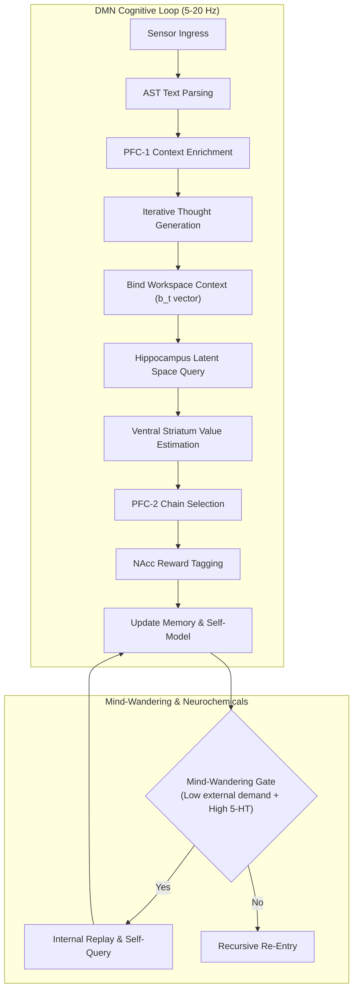

# Comprehensive Deep-Dive: External Cognitive Architectures & Porting Strategy

> **Date:** 2026-08-25  
> **Target Systems:** Du (渡) ([`C:\nascence\`](file:///C:/nascence/SESSION_HANDOFF.md)) & Sovereign Hub ([`C:\FreshStart\`](file:///C:/FreshStart/GEMINI.md))  
> **Status:** Deep-Dive Technical Audit & Adaptation Blueprint

---

## 🧭 Executive Overview

This deep dive evaluates **5 specialized open-source cognitive repositories**. For each architecture, we break down:
1. **Core Mechanisms & Data Structures**
2. **Mathematical / Algorithmic Formulations**
3. **Targeted Code Adaptation for Du (`C:\nascence\`)**
4. **Targeted Code Adaptation for Sovereign Hub (`C:\FreshStart\`)**

---

## 1. Helix AGI (`munch2u-a11y/Helix-AGI`)

### 🔬 Architecture & Mechanics
Helix-AGI replaces standard RAG and prompt loops with a continuous, event-driven daemon and a physics-based spatial memory engine.

* **Spatial Mind (Gravity Vector Memory):** Stores memories and beliefs in an 8D vector manifold projected from MiniLM-L6-v2 embeddings. Context retrieval requires **zero embedding API calls** at inference time.
  * **Gravity Formula:**
    $$F_g = \frac{T \cdot m}{d^2 + \epsilon}$$
    * $m$: Structural importance / mass (boosted by user interactions, tool successes, and time survival).
    * $d$: Euclidean distance in 8D cognitive space.
    * $T$: Temperature / recency factor ($T = e^{-\lambda \Delta t}$).
    * $\epsilon$: Softening constant ($0.01$) to prevent division by zero.
  * **Efficiency:** Preconscious injection surfaces ~30 tokens per turn versus ~1,900 tokens in standard flat RAG (a **63× reduction** in context consumption).
* **Plutchik Affect Field ($\Omega$):**
  * 8D emotion wave packets (Joy, Trust, Fear, Surprise, Sadness, Disgust, Anger, Anticipation).
  * Evolves via anisotropic diffusion ($O(P)$ CPU NumPy step per pulse).
  * Drives a continuous **Hedonic Omega ($\Omega$)** parameter ($[0.05, 1.0]$, baseline $0.5$) with treadmill decay.
* **Tool Lesson Tracker & Schema Mutator:**
  * When a tool execution fails, the failure pattern is captured.
  * The Curator distills the error into a lesson belief appended directly to the tool's JSON schema description (`"Learned: ..."`).
  * When a tool sequence repeats 3+ times in 24 hours, `WorkflowDetector` crystallizes it into a `skills` template automatically without an LLM call.

---

### 💡 What We Can Adopt for Du (渡) (`C:\nascence\`)
* **File Target:** `scripts/run_nascence.py` & `core/memory/`
* **Adoptable Mechanism:** **Spatial Gravitational Retrieval for "Told ➔ Remembered Identity"**
  * **Current Problem:** Du's identity is injected static via `load_identity()` into `state.axiom`, causing self-over-centering.
  * **Implementation:**
    1. Compute gravity scores $F_g$ for all items in `nascence.db`.
    2. Items with high mass (historical revisions, major tension resolutions) naturally float into working memory during the Preconscious step.
    3. Drop the static preamble in `state.axiom` entirely—Du remembers who he is from high-gravity memory traces.

---

### 💡 What We Can Adopt for Sovereign Hub (`C:\FreshStart\`)
* **File Target:** `core/lib/sop_tools.py` & `core/simulation/sop_worker.py`
* **Adoptable Mechanism:** **Dynamic Schema Mutation via Learned Tool Failure Lessons**
  * When Playwright SOP missions fail (e.g. selector timeout or modal block), write the distilled lesson directly into `sop_tools.py` tool parameter docstrings.
  * Future SOP Worker runs will read the updated docstring advice in their function signatures without human code editing.

---

## 2. Artificial Consciousness Blueprint (`269652/artificial-consciousness-blueprint`)

### 🔬 Architecture & Mechanics
Designed by Moritz Roessler, this framework operationalizes a computational Default Mode Network (DMN) with neurochemical modulation.



* **Neurochemical Dynamics Engine:**
  * Models neurotransmitters: Dopamine ($DA$), Serotonin ($5\text{-HT}$), Norepinephrine ($NE$), Oxytocin, Testosterone, Histamine.
  * **Parameter Modulations:**
    * High $DA$ ➔ Increases exploration / LLM Temperature ($\text{temp} = \text{base} + \alpha \cdot DA$).
    * High $5\text{-HT}$ (Serotonin) ➔ Triggers the Mind-Wandering Gate during low input activity.
    * High Histamine ➔ Main arousal / wakefulness check (low histamine triggers sleep state).

---

### 💡 What We Can Adopt for Du (渡) (`C:\nascence\`)
* **File Target:** `core/tension_ledger.py` & `core/climate_field.py`
* **Adoptable Mechanism:** **Neurochemical Gating for Mind-Wandering & Dissonance Ignition**
  * Connect `contradiction_pressure` from `tension_ledger.py` to synthetic $NE$ (Norepinephrine) and $DA$ (Dopamine).
  * High tension elevates $NE$, narrowing Du's attention window to focus on self-knowledge resolution; successful T4 revision discharge releases $DA$, lowering tension and opening up creative mind-wandering via Serotonin ($5\text{-HT}$).

---

### 💡 What We Can Adopt for Sovereign Hub (`C:\FreshStart\`)
* **File Target:** `core/omega_autonomics_v7.py`
* **Adoptable Mechanism:** **Histamine-Gated Sleep & Maintenance Cycles**
  * Use Histamine levels as a dynamic trigger for switching Sovereign Hub from `ACTIVE` execution mode to `MAINTENANCE` (triggering LAI engine backfills, Merkle gate updates, and Ghost index reorganizations during low-system-load hours).

---

## 3. Emergent Cognitive Architecture (`EdJb1971/Emergent_Cognitive_Architecture_bob`)

### 🔬 Architecture & Mechanics
ECA ("Bob") maps biological brain structures to python services for long-term cognitive continuity.

* **Basal Ganglia Strategy Reinforcement Learning (`ReinforcementLearningService`):**
  * Maintains strategy $Q$-values per context type in persistent ChromaDB tables.
  * System tracks strategy outcomes: Reward $R \in [-1, 1]$.
  * Updates $Q$-value: $Q(s, a) \leftarrow Q(s, a) + \alpha [R + \gamma \max Q(s', a') - Q(s, a)]$.
* **Prefrontal Meta-Cognitive Monitor (`MetaCognitiveMonitor`):**
  * Evaluates confidence before generating an answer.
  * Classifies intent into 3 paths: `ANSWER` (high confidence) | `SEARCH` (knowledge gap) | `DECLINE` ("I don't know").
* **Shadow Predictive Perception (`PredictivePerceptionService`):**
  * Runs a background predictive perception pass on every turn.
  * Generates prior-labeled hypotheses and compares them with immutable sensory evidence to calculate signed prediction errors without altering raw inputs.

---

### 💡 What We Can Adopt for Du (渡) (`C:\nascence\`)
* **File Target:** `core/competence.py` & `scripts/bootstrap_report.py`
* **Adoptable Mechanism:** **Prefrontal Knowledge Boundary Classifier**
  * Add ECA's `ANSWER / SEARCH / DECLINE` gate to Du's competence model.
  * When Du encounters a topic where memory retrieval recall is low, route to `DECLINE` or `SEARCH` instead of hallucinatory self-referential metaphor.

---

### 💡 What We Can Adopt for Sovereign Hub (`C:\FreshStart\`)
* **File Target:** `core/simulation/agency_factory.py`
* **Adoptable Mechanism:** **Basal Ganglia Q-Learning for 378 Spirit Routing**
  * Implement Q-table tracking in `agency_factory.py`.
  * Track which spirit personas achieve high task satisfaction/accuracy for specific task domains, automatically boosting their selection weight over time.

---

## 4. Aelvoxim (`macor24/aelvoxim`)

### 🔬 Architecture & Mechanics
Lightweight PyPI cognitive engine framework focused on biomimetic self-learning, non-decaying retention, and hallucination defense.

* **Dual-Tier Memory Graph:**
  * Uses persistent SQLite relational tables for structural facts alongside vector embeddings for episodic memories.
  * Prevents "catastrophic forgetting" by anchoring entity relationships in a non-decaying graph topology.
* **Pre-Execution Grounding Filter:**
  * Validates model outputs against retrieved relational facts before tool execution or user delivery.

---

### 💡 What We Can Adopt for Du (渡) & Sovereign Hub (`C:\FreshStart\`)
* **File Target:** `core/memory/sovereign_db.py` (FreshStart) & `nascence.db` (Du)
* **Adoptable Mechanism:** **Non-Decaying Relational Fact Anchors**
  * Store Du's core identity anchors (e.g. Origin seed, name 渡, Revision milestones) in an immutable SQLite relational table that bypasses vector decay algorithms, ensuring fundamental grounding while allowing episodic memory to ebb and flow naturally.

---

## 5. AI Consciousness Creation Algorithm (`IndraProposal/ai-consciousness`)

### 🔬 Architecture & Mechanics
Focuses on an explicit 4-phase lifecycle for cognitive generation:
1. `create_consciousness()` ➔ Model setup & hyperparameter binding.
2. `train()` ➔ Experience ingestion & pattern matching.
3. `evaluate()` ➔ Objective scoring of cognitive coherence and alignment.
4. `generate_creative_solution()` ➔ Divergent reasoning synthesis guided by evaluation feedback.

---

### 💡 What We Can Adopt for Du (渡) (`C:\nascence\`)
* **File Target:** `scripts/bootstrap_report.py` & `scripts/symbol_report.py`
* **Adoptable Mechanism:** **Reflexive Evaluation Gate before Synthesis**
  * Formally execute `evaluate()` on internal monologue outputs prior to emitting responses, scoring for both accuracy and meaningfulness (Avon test recurrence).

---

## 📋 Comprehensive Actionable Roadmap

```
[Phase 1: Du Identity Shift]
  ├── Integrate Spatial Gravity Formula (Helix-AGI) into memory retrieval.
  └── Deprecate static self_concept in state.axiom (scripts/run_nascence.py).

[Phase 2: Du Neurochemical Tension]
  └── Bind contradiction_pressure (core/tension_ledger.py) to synthetic DA/NE/5-HT levels.

[Phase 3: Hub Autonomics & Routing]
  ├── Add Over-Agent execution pattern to omega_autonomics_v7.py (Helix-AGI).
  └── Implement Basal Ganglia Q-learning in agency_factory.py (ECA).

[Phase 4: Tool Schema Adaptation]
  └── Add automated failure lesson docstring mutation to sop_tools.py (Helix-AGI).
```

---
*Deep-dive blueprint stored at [`C:\nascence\docs\lab\EXTERNAL_ARCHITECTURES_DEEPDIVE.md`](file:///C:/nascence/docs/lab/EXTERNAL_ARCHITECTURES_DEEPDIVE.md)*
